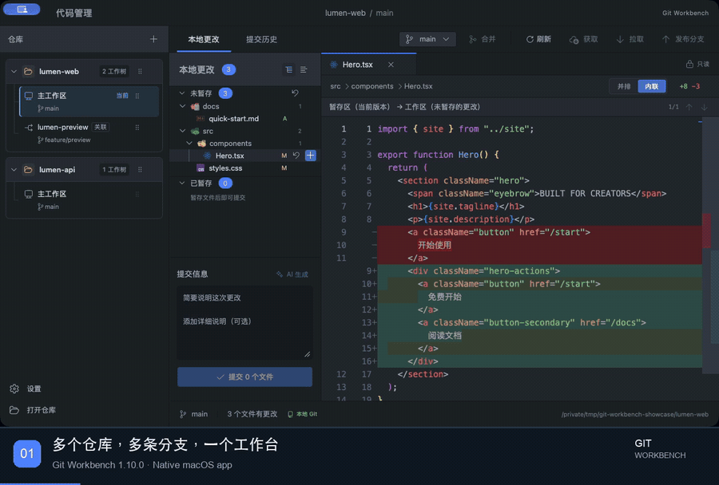

<p align="center">
  
</p>

<h1 align="center">Git Workbench</h1>

<p align="center">
  <strong>Your local repositories. Your next commit. One workspace.</strong><br>
  Switch between projects and worktrees, review diffs, and commit with confidence.
</p>

<p align="center">
  <a href="https://github.com/asd116725/git-workbench/releases/latest"></a>
  
  <a href="LICENSE"></a>
</p>

<p align="center">
  <a href="https://github.com/asd116725/git-workbench/releases/latest"><strong>Download for macOS</strong></a> ·
  <a href="#see-it-in-action">Watch the demo</a> ·
  <a href="docs/user-manual.md">User manual</a> ·
  <a href="https://github.com/asd116725/git-workbench/issues">Report an issue</a>
</p>

<p align="center"><strong>English</strong> · <a href="README.zh-CN.md">简体中文</a></p>

Git Workbench is a desktop Git client for developers working across multiple local projects and parallel feature branches. Keep repositories and linked worktrees together, inspect exactly what you are staging, and follow a change through its commit history.

It uses your installed Git and existing author, signing, hooks, and remote credential settings.

## See it in action

[](https://github.com/asd116725/git-workbench/releases/download/v1.10.0/GitWorkbench_1.10.0_demo.mp4)

18-second preview above · **[Download the full 63-second demo →](https://github.com/asd116725/git-workbench/releases/download/v1.10.0/GitWorkbench_1.10.0_demo.mp4)**

A 63-second walkthrough: custom names and ordering → worktree switching → diffs and staging → commits and history → appearance.

Recorded in the native app with fictional local projects and real Git operations. Chinese UI and captions, with English notes. Pauses are edited and some clips accelerated; sorting is shown with keyboard arrows.

## Your daily Git workflow

| Feature | What it helps you do |
| --- | --- |
| **Repositories & worktrees** | Switch between local repositories and linked worktrees. Customize [display names](docs/user-manual.md#31-custom-display-names-1100) and drag to [reorder the sidebar](docs/user-manual.md#32-sidebar-ordering-1100); both survive restarts. |
| **Diffs & staging** | Read inline or side-by-side diffs. Stage or unstage files, directories, or entire groups; discard unstaged changes after confirmation. Commit staged content while keeping other edits. |
| **Branches & sync** | Search, create, delete, and merge branches. Fetch, pull, push, or publish a new branch, with incoming and outgoing commit counts. |
| **Commit history** | Browse commits, changed files, and historical diffs together. Search the selected branch's full reachable history and identify unpushed commits. |
| **Optional AI drafts** | Ask DeepSeek for a commit-message candidate based on staged changes. Review and edit it, then explicitly apply it before committing. |
| **A comfortable workspace** | Adjust pane widths, code font size, and diff mode. Choose Light, Dark, or System appearance and English, Simplified Chinese, or Traditional Chinese. |

**AI setup and data:** configure `DEEPSEEK_API_KEY` to enable generation. Requests send staged diffs, necessary index context, commit conventions, and recent commit titles to DeepSeek. Manual commits remain available without AI. [Setup and review workflow →](docs/user-manual.md#ai-generated-commit-messages-170)

## Download and get started

**v1.10.0 · macOS Apple Silicon (arm64)**

| Download | Link |
| --- | --- |
| macOS installer | [GitWorkbench_1.10.0_macos_arm64.dmg](https://github.com/asd116725/git-workbench/releases/download/v1.10.0/GitWorkbench_1.10.0_macos_arm64.dmg) |
| SHA-256 checksums | [SHA256SUMS.txt](https://github.com/asd116725/git-workbench/releases/download/v1.10.0/SHA256SUMS.txt) |
| Release notes | [What's new in v1.10.0](https://github.com/asd116725/git-workbench/releases/tag/v1.10.0) |

1. **Install.** Verify the DMG with the checksum file from the same release, then drag **代码管理** (Git Workbench) into Applications. [Installation guide →](docs/installation.md)
2. **Open your project.** Make sure `git --version` works, choose **Open repository**, and select an existing local repository. Its linked worktrees appear alongside it.
3. **Make your next commit.** Review the diffs, stage the intended files, write a message or review an AI draft, and commit. Fetch, pull, or push when ready.

The app is **ad-hoc signed and not Apple-notarized**. See [first-launch instructions](docs/installation.md#first-launch) for macOS prompts. Official packages are available only for Apple Silicon; Intel Mac, Windows, and Linux installers are not provided. The build targets macOS 12 or later; older macOS compatibility has not been fully verified.

## Support and limitations

- **Local repositories:** open existing repositories and linked worktrees. Cloning, initialization, and creating or removing worktrees require Git or another tool.
- **Desktop staging:** files, directories, and groups are supported. Individual-hunk staging and a built-in conflict editor are not available; resolve conflicts in your editor, then return to finish the merge.
- **Branch synchronization:** switching to a branch with a remote upstream checks for updates and attempts a fast-forward pull. Sync counts use locally fetched refs; use **Fetch** to update them. [Branch and remote workflows →](docs/user-manual.md#43-fetch-pull-and-push)
- **Session drafts:** commit drafts last only for the current app session. Save them before fully quitting with `⌘Q` or updating. Repository paths, display names, ordering, and preferences persist.
- **Updates:** download and install new versions from [Releases](https://github.com/asd116725/git-workbench/releases); there is no automatic updater.

See the [user manual](docs/user-manual.md) for diff limits, conflict handling, refresh behavior, and troubleshooting.

## Run from source

Built with **Tauri 2 + Rust**, **React + TypeScript**, and **Monaco Editor + Shiki**.

Requires Node.js **22.14+ within major version 22**, pnpm **11.17.0**, Rust **1.99.0**, and Git. On macOS, install Xcode Command Line Tools with `xcode-select --install`.

```sh
git clone https://github.com/asd116725/git-workbench.git
cd git-workbench
pnpm install --frozen-lockfile
pnpm desktop
```

For an interface-only preview, run `pnpm dev`. Browser mode uses separate demo data and does not operate on local repositories. See [Contributing](CONTRIBUTING.md) for checks and the [release guide](docs/releasing.md) for packaging.

## Documentation and contributing

| Looking for | Start here |
| --- | --- |
| Everyday workflows and troubleshooting | [User manual](docs/user-manual.md) |
| Installing or updating the app | [Installation guide](docs/installation.md) |
| Changes in each version | [Changelog](CHANGELOG.md) |
| Bugs and feature requests | [GitHub Issues](https://github.com/asd116725/git-workbench/issues) |
| Contributing code or documentation | [Contributing guide](CONTRIBUTING.md) |

## License

Project code is licensed under [MIT](LICENSE). Third-party icons, fonts, themes, and software retain their own licenses; see [third-party notices](THIRD-PARTY-NOTICES.md).
