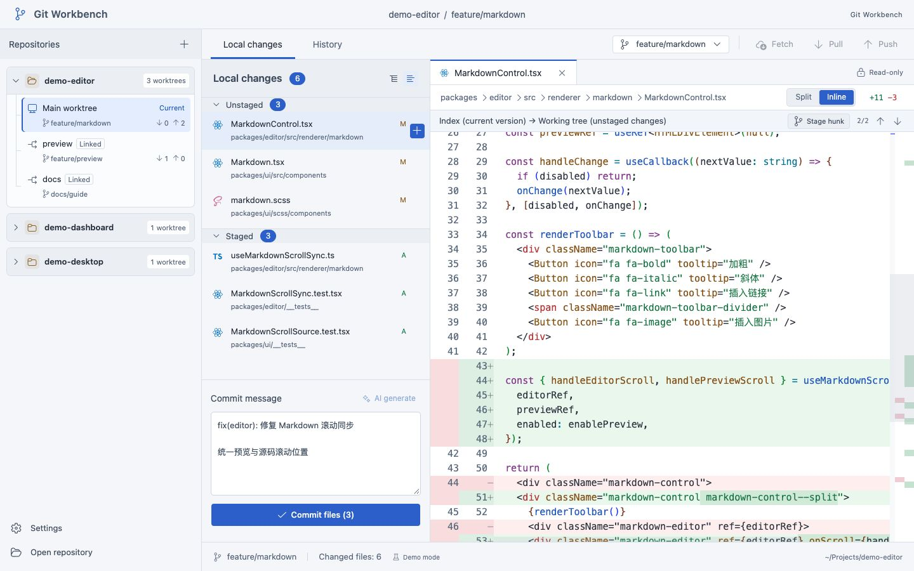
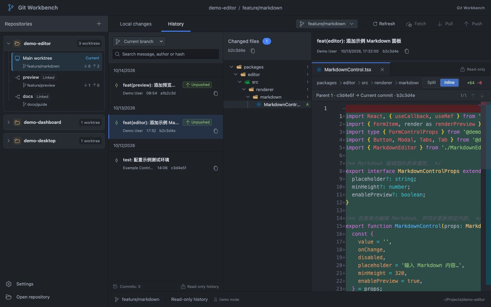

<p align="center">
  
</p>

<h1 align="center">Git Workbench</h1>

<p align="center">
  <strong>A desktop workspace for your local Git repositories.</strong><br>
  Review changes, manage worktrees, and prepare your next commit in one window.
</p>

<p align="center">
  <a href="https://github.com/asd116725/git-workbench/releases/latest"></a>
  
  <a href="LICENSE"></a>
</p>

<p align="center">
  <a href="https://github.com/asd116725/git-workbench/releases/latest"><strong>Download for macOS</strong></a> ·
  <a href="docs/user-manual.md">User manual</a> ·
  <a href="CHANGELOG.md">What's new</a> ·
  <a href="https://github.com/asd116725/git-workbench/issues">Report an issue</a>
</p>

<p align="center"><strong>English</strong> · <a href="README.zh-CN.md">简体中文</a></p>

Git Workbench brings repositories, linked worktrees, branches, diffs, and commit history into a single desktop app. It is built for developers working across several local projects or parallel feature branches who want to review exactly what goes into each commit.

Use your existing Git configuration for authors, signing, hooks, and remote credentials. Optional DeepSeek assistance can turn staged changes into a commit-message draft in your current interface language for you to review.



*v1.8.0 light appearance preview with fictional demo data. The browser demo includes hunk-staging controls; the desktop app currently stages files, directories, and groups. See [support and limitations](#support-and-limitations).*

## Your daily Git workflow, in one place

| Work with | What you can do |
| --- | --- |
| **Repositories & worktrees** | Open existing local repositories, discover linked worktrees, and move between parallel branches from the sidebar. Restore your repositories and last selected worktree when you reopen the app. |
| **Diffs & staging** | Browse a file tree or flat list, read side-by-side or inline diffs, and stage or unstage files, directories, or all changes. Commit the staged content while keeping unstaged edits. |
| **Branches & synchronization** | Search, create, delete, and merge branches. Fetch, pull, push, or publish a branch for the first time. See incoming and outgoing counts in the sidebar, branch list, and toolbar. |
| **Commit history** | Browse commits, changed files, and historical diffs together. Search the selected branch's full reachable history, compare merge parents, and spot commits that have not been pushed. |
| **AI commit drafts** | Generate Conventional Commit messages from staged changes with DeepSeek in your current interface language. Preview, edit, and explicitly apply a candidate before committing. |
| **A workspace that fits** | Adjust pane widths, font size, and diff mode. Choose Light, Dark, or System appearance, with file-type icons and English, 简体中文, or 繁體中文. |

Switching to a branch with a remote upstream checks for updates and attempts a fast-forward pull. If local changes, diverged history, or a network error prevent synchronization, the app preserves the completed switch and explains what needs attention. Resolve conflicted files in your editor, then complete the merge in the app; you can also abort a merge from the app.

Since **1.8.0**, choose **Settings → Appearance → Light / Dark / System**. The interface, code editor, and native window update together, and your choice is remembered. Switching appearances preserves the current worktree, diff reading position, and commit draft.

### Follow the history behind a change

Select a commit to see its message, changed files, and diff without changing your working branch. History filters affect what you browse, not what is checked out.



*v1.8.0 dark appearance history preview with fictional repositories, paths, authors, and commits.*

## AI commit messages, with a review step

The optional AI workflow introduced in **1.7.0** uses DeepSeek and the `staged-commit-message-zh` writing rules. Generation follows **Settings → Interface language**: English, Simplified Chinese, or Traditional Chinese. Each generation or regeneration uses the current selection; switching languages does not translate or overwrite an existing draft or candidate.

1. **Stage the changes** you want to include in the commit.
2. Choose **AI generate**, then review and edit the candidate.
3. Choose **Use this message** or **Replace draft**, review the commit form, and commit when ready.

Generation does not stage files, commit, or push. Canceling or encountering an error keeps the existing draft; changing the staged content, HEAD, or branch invalidates an outdated candidate.

**Setup and data:** configure `DEEPSEEK_API_KEY` in your local environment. The native app reads the key; it is not stored in frontend preferences or included in the installer. When you request generation, staged diffs and necessary index context, commit conventions, and recent subject lines are sent to DeepSeek. Unstaged edits and unrelated untracked files are excluded. AI requires a DeepSeek account and network access; manual commits remain available.

[AI setup, supported inputs, and troubleshooting →](docs/user-manual.md#ai-generated-commit-messages-170)

## Install and start

The current stable release is **1.8.2**, available for **macOS Apple Silicon (arm64)**.

| Download | Link |
| --- | --- |
| macOS installer | [GitWorkbench_1.8.2_macos_arm64.dmg](https://github.com/asd116725/git-workbench/releases/download/v1.8.2/GitWorkbench_1.8.2_macos_arm64.dmg) |
| SHA-256 checksums | [SHA256SUMS.txt](https://github.com/asd116725/git-workbench/releases/download/v1.8.2/SHA256SUMS.txt) |
| Release notes | [What's new in v1.8.2](https://github.com/asd116725/git-workbench/releases/tag/v1.8.2) |

1. **Install:** verify the DMG against the checksum file from the same release, then drag **代码管理** (Git Workbench) into Applications. See the [installation guide](docs/installation.md).
2. **Open a repository:** make sure `git --version` works, then choose **Open repository** in the app and select an existing local repository.
3. **Review and stage:** select files to inspect their diffs, then use the row or group actions to stage the changes you want to commit.
4. **Commit and sync:** write a message or use the optional AI draft, commit, then fetch, pull, or push as needed.

The installer is **ad-hoc signed, without Apple Developer ID signing or notarization**. For macOS prompts, see [first launch](docs/installation.md#first-launch). Official installers for Intel Mac, Windows, and Linux are not available. The build targets macOS 12 or later; compatibility with every older macOS version has not been established.

## Support and limitations

- **Existing repositories:** open repositories already on your machine. Cloning and initialization are handled outside the app.
- **Desktop staging:** stage files, directories, or groups. Individual-hunk staging and conflict editing are not available in the desktop app; resolve conflicts in your editor.
- **Drafts:** commit drafts last for the current app session. Save them before quitting with `⌘Q` or updating. Repository paths, layout, and language preferences are restored on launch.
- **Remote state:** counts use locally fetched upstream refs, not a live server query. Use **Fetch** to update them. A branch without an upstream shows **Publish branch**, without treating its full history as unpushed commits.
- **Diff coverage:** binary files, non-UTF-8 text, files over 2 MiB, submodules, and unresolved conflicts may show an explanation instead of a text diff.
- **Updates:** install new versions manually from [GitHub Releases](https://github.com/asd116725/git-workbench/releases); there is no automatic updater.

<details>
<summary>Desktop app and browser demo support</summary>

| Capability | Desktop app | Browser demo |
| --- | --- | --- |
| Local repositories, worktrees, and branch switching | Real Git operations | Fictional data |
| Branch creation and deletion | Real Git operations | In-memory demo |
| File diffs, staging, and commits | Real Git operations | In-memory demo |
| History, branch filters, and historical diffs | Real Git data | Fictional data |
| Fetch, pull, push, and branch merging | Real Git operations | Not available |
| DeepSeek commit-message generation | Optional, with your API key | Not available |
| Individual-hunk staging | Not available | Demo only |
| Conflict editing | Not available | Not available |

</details>

<details>
<summary>Refresh and session behavior</summary>

Filesystem changes refresh the active worktree after a 1-second debounce while the app is in the foreground and idle, followed by a cooldown of at least 5 seconds. Background changes are handled together when you return. Refreshes preserve the current reading position and commit draft; **Refresh** also provides an immediate read.

Closing the macOS window hides it while the process stays running; clicking the Dock icon restores it. A full quit ends the session and discards commit drafts. Unavailable repository paths show an error without blocking the remaining repositories from reopening.

History pages contain 50 commits, and search covers the selected branch's full reachable history. New commits trigger a manual-refresh prompt so the diff you are reading stays in place.

</details>

## Built with

**Tauri 2 + Rust** for the desktop shell and Git integration, **React + TypeScript** for the interface, and **Monaco Editor + Shiki** for diffs and syntax highlighting. Repository operations use the Git installed on your machine.

### Run from source

You need Node.js **22.14+ within major version 22**, pnpm **11.17.0**, Rust **1.99.0** (selected by the repository toolchain), and Git. macOS desktop builds also require Xcode Command Line Tools: `xcode-select --install`.

```sh
git clone https://github.com/asd116725/git-workbench.git
cd git-workbench
pnpm install --frozen-lockfile
pnpm desktop
```

For an interface-only preview, run `pnpm dev` and open the local URL printed in the terminal. Browser mode uses separate demo data and does not operate on local repositories.

<details>
<summary>Development checks and packaging</summary>

```sh
pnpm typecheck
pnpm lint
pnpm test
pnpm build
cargo fmt --manifest-path src-tauri/Cargo.toml -- --check
cargo test --locked --manifest-path src-tauri/Cargo.toml
pnpm release:check --tag v1.8.2
```

```sh
# Build the .app only
pnpm desktop:build

# Build an arm64 DMG, checksums, and release notes (macOS required)
pnpm desktop:package
```

The `.app` is written to `src-tauri/target/release/bundle/macos/`; standardized release files go to `release-artifacts/`. See the [release guide](docs/releasing.md) for versioning and GitHub Actions.

</details>

## Documentation and contributing

| Looking for | Start here |
| --- | --- |
| Everyday Git workflows | [User manual](docs/user-manual.md) |
| Installing, updating, or macOS prompts | [Installation guide](docs/installation.md) |
| Changes in each version | [Changelog](CHANGELOG.md) |
| Bugs and feature requests | [GitHub Issues](https://github.com/asd116725/git-workbench/issues) |
| Contributing code or documentation | [Contributing guide](CONTRIBUTING.md) |
| Preparing a release | [Maintainer's release guide](docs/releasing.md) |

## License

Project code is licensed under [MIT](LICENSE). Codicons, vscode-icons, the Geist font, the Atom One Dark and One Light themes, and third-party software retain their own licenses. See [third-party notices](THIRD-PARTY-NOTICES.md); license copies are included in the app bundle.
