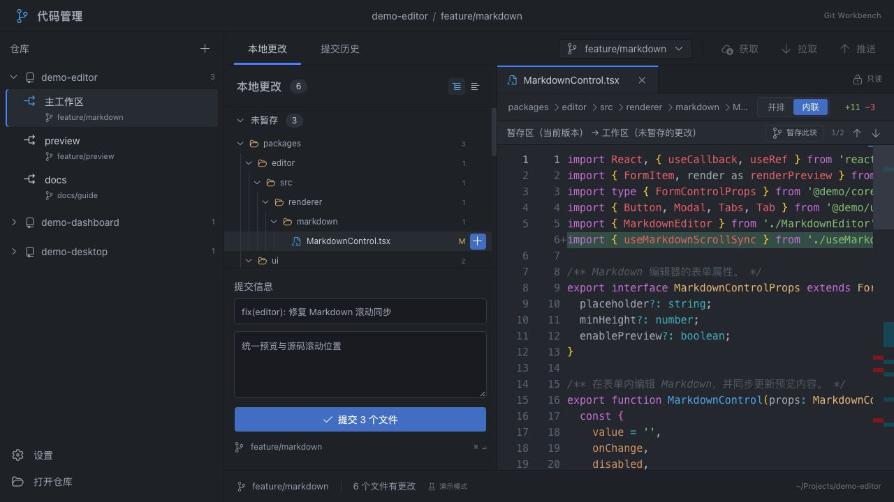

# Git Workbench · 代码管理

一个面向本地仓库的 Git 桌面工具。使用 Tauri 2、React 和 TypeScript 构建，将 worktree、分支、文件变更与 Diff 放在同一个窗口中。

[下载 v0.1.2 预发布版](https://github.com/asd116725/git-workbench/releases/tag/v0.1.2) · [中文操作手册](docs/user-manual.md) · [安装说明](docs/installation.md) · [更新日志](CHANGELOG.md)



## 可以做什么

- 打开已有的本地 Git 仓库，自动列出关联 worktree，并在工作区之间切换。
- 搜索本地和已获取的远程分支，按最近提交排序，查看作者、短哈希和提交摘要。
- 用目录树或列表查看文件变更，阅读只读的并排或内联 Diff。
- 将单个文件、整个目录或整组变更加入暂存区，或取消暂存。
- 填写提交标题和说明，提交暂存区内容，保留未暂存修改。
- 调整分栏宽度、代码字号和 Diff 模式；使用 Atom One Dark 配色。

截图中的仓库、路径、作者和提交记录均为虚构演示数据。

## 安装与快速上手

当前版本提供 **macOS Apple Silicon（arm64）** 安装包。Intel Mac、Windows、Linux 暂无官方构建。

1. 从 [v0.1.2 Release](https://github.com/asd116725/git-workbench/releases/tag/v0.1.2) 下载 [DMG](https://github.com/asd116725/git-workbench/releases/download/v0.1.2/GitWorkbench_0.1.2_macos_arm64.dmg) 和 `SHA256SUMS.txt`。
2. 按[安装说明](docs/installation.md)校验文件，将「代码管理」拖入 Applications 后打开。
3. 点击「打开本地仓库」，选择已有仓库的目录。应用使用本机 Git，请先确认 `git --version` 可以运行。
4. 选择文件阅读 Diff，在行末点击 `+` 暂存；填写提交标题，点击提交按钮。

当前版本采用 **ad-hoc 签名，未进行 Developer ID 签名及 Apple 公证**。macOS 可能要求确认来源；处理方式见[首次打开](docs/installation.md#首次打开)。

## 支持范围与限制

| 功能 | 桌面应用 | 浏览器演示 |
| --- | --- | --- |
| 本地仓库、worktree、分支切换 | 支持 | 虚构数据 |
| 文件 Diff、文件/目录/整组暂存和提交 | 支持真实 Git | 仅内存演示 |
| 按变更块暂存、提交历史 | 暂未提供 | 仅演示 |
| Fetch、Pull、Push、冲突编辑 | 暂未提供 | 暂未提供 |

- 外部工具更改仓库后，点击「刷新」读取最新状态。切回应用不会自动重新加载。
- 已打开的本地仓库与上次选中的工作区会自动保存，重启后恢复并读取最新 Git 状态；不可用路径会提示错误，其余仓库继续恢复。提交草稿仅保留在当前会话中；字号和布局偏好会保存。
- 二进制文件、非 UTF-8 文本、超过 2 MiB 的文件、子模块或未解决冲突可能只显示说明，不能作为普通文本 Diff 展示。
- 分支列表仅包含本地已有引用；需要先在终端或其他工具中获取新的远程分支。
- 构建配置最低系统为 macOS 12，当前版本仅在维护者当前的 arm64 macOS 环境验收，旧系统兼容性仍需反馈。
- 更新方式为手动下载 GitHub Release，应用不包含自动更新服务。

## 源码启动

需要 Node.js **22.14+**（同一主版本）、pnpm **11.17.0**、Rust **1.99.0**（仓库工具链文件自动选择）及系统 Git。macOS 桌面构建还需要 Xcode Command Line Tools：`xcode-select --install`。

```sh
git clone https://github.com/asd116725/git-workbench.git
cd git-workbench
pnpm install --frozen-lockfile
pnpm desktop
```

只看界面可运行 `pnpm dev`，访问终端给出的本地地址。浏览器使用独立的演示数据，不会操作本机仓库。

## 检查与构建

```sh
pnpm typecheck
pnpm lint
pnpm test
pnpm build
cargo fmt --manifest-path src-tauri/Cargo.toml -- --check
cargo test --locked --manifest-path src-tauri/Cargo.toml
pnpm release:check --tag v0.1.2
```

```sh
# 只生成 .app，保持原有构建方式
pnpm desktop:build

# 生成 arm64 DMG、SHA-256 校验文件和发布说明（需要 macOS）
pnpm desktop:package
```

`.app` 位于 `src-tauri/target/release/bundle/macos/`；标准化发布文件位于 `release-artifacts/`。版本维护及 GitHub Actions 发布步骤见[维护者发布指南](docs/releasing.md)。

## 文档与参与

- [操作手册](docs/user-manual.md)：仓库、worktree、分支、Diff、暂存和提交。
- [安装说明与常见系统提示](docs/installation.md)。
- [贡献指南](CONTRIBUTING.md)和[问题反馈](https://github.com/asd116725/git-workbench/issues)。
- [版本更新日志](CHANGELOG.md)与[发布指南](docs/releasing.md)。

项目代码采用 [MIT](LICENSE) 许可证。Codicons 图标、Geist 字体、Atom One Dark 主题及第三方软件保留各自许可证，详见 [THIRD-PARTY-NOTICES](THIRD-PARTY-NOTICES.md)。应用包中附带许可副本。
