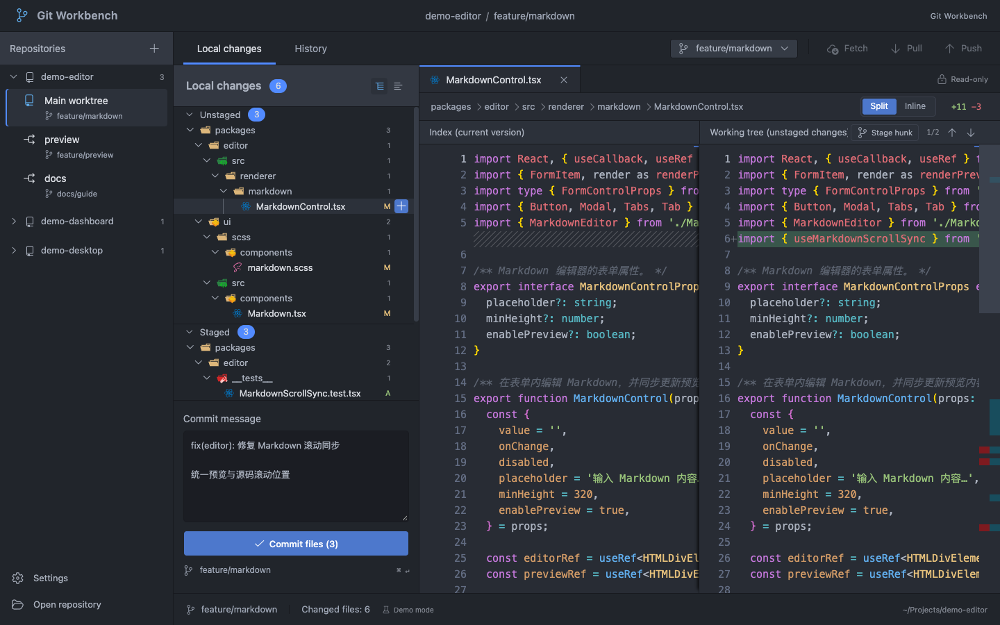
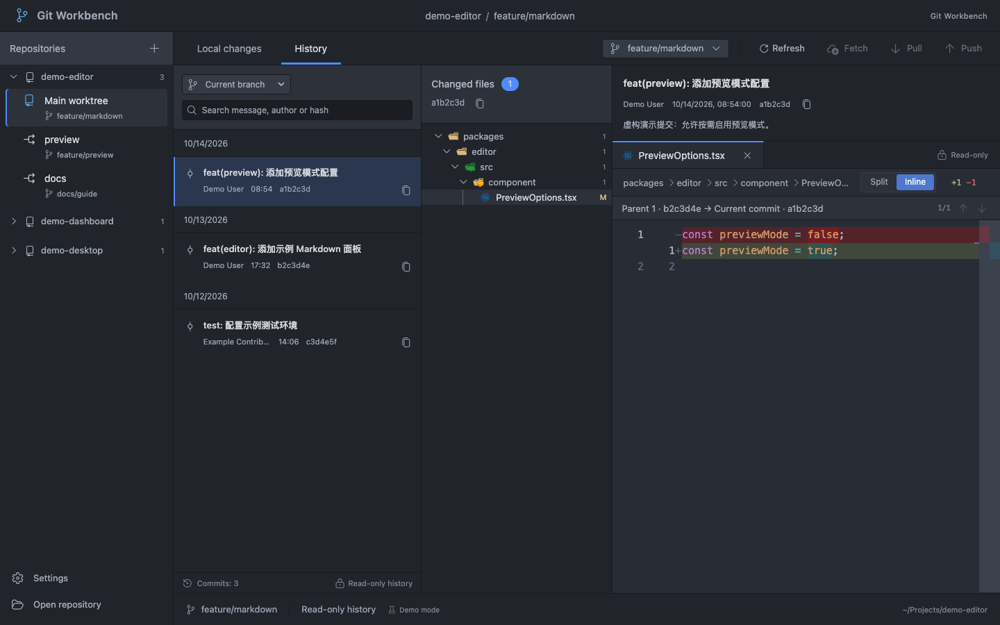

# Git Workbench

**English** | [简体中文](README.zh-CN.md)

A desktop Git client for local repositories, built with Tauri 2, React, and TypeScript. Work with worktrees, branches, file changes, and diffs in one window.

[Download v1.3.0](https://github.com/asd116725/git-workbench/releases/tag/v1.3.0) · [User manual](docs/user-manual.md) · [Installation](docs/installation.md) · [Changelog](CHANGELOG.md)

The current stable release is **1.3.0**. Download `GitWorkbench_1.3.0_macos_arm64.dmg` and `SHA256SUMS.txt` from the same release, then verify the checksum before installing.

*The screenshots show the English development preview. The published 1.3.0 installer uses Chinese.*



## Features

- Open an existing local Git repository, discover its linked worktrees, and switch between them.
- Search local and fetched remote branches, sorted by latest commit, with author, short hash, and commit summary.
- Fetch remote updates, pull with fast-forward only, and push the current branch. See the outgoing commit count beside the push icon and set an upstream on the first push.
- Create and delete local branches, with an option to switch after creation. Deletion checks for unmerged commits and worktree usage. Available since 1.2.0; see [branch management](docs/user-manual.md#42-creating-and-deleting-local-branches).
- Browse changes as a tree or flat list and read side-by-side or inline diffs.
- Recognize files and folders with bundled vscode-icons, consistently matched by name and type across changes, history, and diff tabs. No network connection required.
- Stage or unstage a file, a directory, or an entire group of changes.
- Write a commit message in one multiline field: the first line is the subject, and the remaining lines are the body. Commit staged changes while keeping unstaged edits.
- Automatically refresh the active worktree after filesystem changes, preserving the reading position and commit draft for the current session.
- Explore repository history in three panes: commits, changed files, and diff. Filter by branch, search the full reachable history, and choose a parent when comparing merge commits.
- Adjust pane widths, code font size, and diff mode, with an Atom One Dark color scheme.
- **In development:** switch instantly between Simplified Chinese, Traditional Chinese, and English in settings, with the choice saved for future launches. This is available in the current source and is **not included in the published 1.3.0 installer**.

Repositories, paths, authors, and commits in the screenshots are fictional demo data.

Version `1.1.0` introduced **branch merging, completing or aborting a conflicted merge, and read-only commit history**. See [merging branches](docs/user-manual.md#41-merging-branches) and [commit history](docs/user-manual.md#81-commit-history).



## Install and get started

The current release provides a **macOS Apple Silicon (arm64)** installer. Official builds for Intel Mac, Windows, and Linux are not available yet.

1. Download the [DMG](https://github.com/asd116725/git-workbench/releases/download/v1.3.0/GitWorkbench_1.3.0_macos_arm64.dmg) and `SHA256SUMS.txt` from the [v1.3.0 release](https://github.com/asd116725/git-workbench/releases/tag/v1.3.0).
2. Follow the [installation guide](docs/installation.md) to verify the download, drag **代码管理** into Applications, and open it.
3. Click **Open local repository** (打开本地仓库 in v1.3.0) and choose an existing repository. The app uses your installed Git; make sure `git --version` works first.
4. Select a file to read its diff, click `+` at the end of the row to stage it, enter a commit message, and commit.

Version 1.3.0 is a stable release, but its installer is **ad-hoc signed, without Apple Developer ID signing or notarization**. The stable release designation does not change its signing status. macOS may ask you to confirm its source; see [first launch](docs/installation.md#first-launch).

## Support and limitations

| Feature | Desktop app | Browser demo |
| --- | --- | --- |
| Local repositories, worktrees, and branch switching | Supported | Fictional data |
| Creating and deleting local branches (1.2.0) | Real Git operations | In-memory demo only |
| File diffs, staging files/directories/groups, and commits | Real Git operations | In-memory demo only |
| Commit history, branch filters, and historical diffs | Real Git data | Fictional data |
| Merging branches, completing and aborting merges | Real Git operations | Not available |
| Staging individual hunks | Not available | Demo only |
| Fetch, pull, and push (1.3.0) | Real Git operations | Not available |
| Conflict editing | Not available | Not available |

- Filesystem watching refreshes the active worktree after a 1-second debounce, while the app is in the foreground and idle. Each automatic refresh is followed by a cooldown of at least 5 seconds. Changes made in the background are handled together when the app returns to the foreground; no changes means no refresh. **Refresh** is also available for an immediate read.
- Open repositories and the last selected worktree are saved and restored on launch, with fresh Git state. Unavailable paths show an error without blocking the other repositories. Commit drafts last only for the current session; font size and layout preferences are saved.
- Binary files, non-UTF-8 text, files larger than 2 MiB, submodules, and unresolved conflicts may show an explanation instead of a normal text diff.
- Branch lists contain locally available refs. Use **Fetch** to update remote branches. See the [remote operations guide](docs/user-manual.md#43-fetch-pull-and-push), including first-push behavior.
- History reads Git commit objects without modifying the worktree; filtering by branch does not switch branches. Pages contain 50 commits, and search covers the selected branch's full reachable history. New commits trigger a manual-refresh prompt so the diff you are reading stays in place.
- The build configuration targets macOS 12 or later. The current release has been checked only on the maintainer's current arm64 macOS environment; feedback on older systems is welcome.
- Updates are installed manually from GitHub Releases. There is no automatic update service.

## Run from source

You need Node.js **22.14+** within major version 22, pnpm **11.17.0**, Rust **1.99.0** (selected by the repository's toolchain file), and Git. macOS desktop builds also require Xcode Command Line Tools: `xcode-select --install`.

```sh
git clone https://github.com/asd116725/git-workbench.git
cd git-workbench
pnpm install --frozen-lockfile
pnpm desktop
```

To preview the interface only, run `pnpm dev` and open the local URL printed in the terminal. The browser uses separate demo data and does not operate on local repositories.

## Checks and builds

```sh
pnpm typecheck
pnpm lint
pnpm test
pnpm build
cargo fmt --manifest-path src-tauri/Cargo.toml -- --check
cargo test --locked --manifest-path src-tauri/Cargo.toml
pnpm release:check --tag v1.3.0
```

```sh
# Build the .app only
pnpm desktop:build

# Build an arm64 DMG, SHA-256 checksums, and release notes (macOS required)
pnpm desktop:package
```

The `.app` is written to `src-tauri/target/release/bundle/macos/`; standardized release files go to `release-artifacts/`. See the [maintainer's release guide](docs/releasing.md) for versioning and the GitHub Actions release workflow.

## Documentation and contributing

- [User manual](docs/user-manual.md): repositories, worktrees, branches, diffs, staging, commits, merging, and history.
- [Installation and macOS prompts](docs/installation.md).
- [Contributing guide](CONTRIBUTING.md) and [issue tracker](https://github.com/asd116725/git-workbench/issues).
- [Changelog](CHANGELOG.md) and [release guide](docs/releasing.md).

Project code is licensed under [MIT](LICENSE). Codicons, vscode-icons, the Geist font, the Atom One Dark theme, and third-party software retain their own licenses; see [third-party notices](THIRD-PARTY-NOTICES.md). License copies are included in the app bundle.
