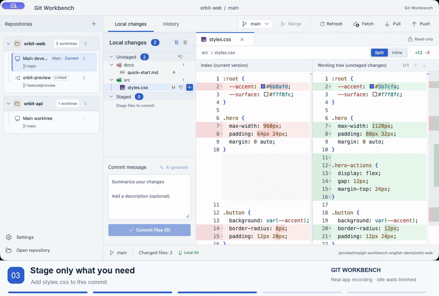

<p align="center">
  
</p>

<h1 align="center">Git Workbench · 代码管理</h1>

<p align="center">
  <strong>多个仓库，多条分支，一个工作台。</strong><br>
  切换项目与 worktree，核对每一处修改，再完成提交。
</p>

<p align="center">
  <a href="https://github.com/asd116725/git-workbench/releases/latest"></a>
  
  <a href="LICENSE"></a>
</p>

<p align="center">
  <a href="https://github.com/asd116725/git-workbench/releases/latest"><strong>下载 macOS 版</strong></a> ·
  <a href="#看看实际操作">观看演示</a> ·
  <a href="docs/zh-CN/feature-guide.md">完整图文指南</a> ·
  <a href="https://github.com/asd116725/git-workbench/issues">问题反馈</a>
</p>

<p align="center"><a href="README.md">English</a> · <strong>简体中文</strong></p>

Git Workbench 是面向多项目、多分支开发的桌面 Git 客户端。把本地仓库和关联 worktree 放在一起，提交前看清暂存内容，也能从提交历史追到具体修改。

应用沿用本机安装的 Git，以及现有的作者信息、签名、hooks 和远程凭据配置。

## 看看实际操作

[](https://github.com/asd116725/git-workbench/releases/download/v1.10.0/GitWorkbench_1.10.0_demo_en.mp4)

上方为约 14 秒预览 · **[观看或下载完整英文演示 · 约 38 秒 →](https://github.com/asd116725/git-workbench/releases/download/v1.10.0/GitWorkbench_1.10.0_demo_en.mp4)**

**[逐项查看 20 个功能的图片与操作说明 →](docs/zh-CN/feature-guide.md)**

在原生应用中录制，采用英文界面、英文字幕与虚构示例项目。Git 操作真实执行，同步演示使用本地 bare 仓库作为离线远端。仅剪去静止等待，操作按原速播放。

## 日常 Git 工作，在这里完成

| 核心功能 | 可以做什么 |
| --- | --- |
| **仓库与 worktree** | 切换本地仓库与关联工作树，自定义[显示名称](docs/zh-CN/user-manual.md#31-自定义显示名称1100)，拖动调整[侧栏顺序](docs/zh-CN/user-manual.md#32-侧栏排序1100)；名称与顺序在重启后保留。 |
| **Diff 与暂存** | 查看内联或并排 Diff，暂存或取消暂存文件、目录及整组变更，确认后撤销未暂存修改；只提交暂存内容，保留其他编辑。 |
| **分支与同步** | 搜索、创建、删除及合并分支，获取、拉取、推送或首次发布分支，查看待拉取和待推送数量。 |
| **提交历史** | 同时浏览提交列表、变更文件与历史 Diff，搜索所选分支的完整可达历史，识别尚未推送的记录。 |
| **可选 AI 草稿** | 使用 DeepSeek 根据暂存修改生成候选提交信息，先预览编辑，再明确填入草稿并手动提交。 |
| **阅读与操作体验** | 调整分栏宽度、代码字号和 Diff 模式，选择浅色、深色或跟随系统外观，支持简体中文、繁體中文与 English。 |

**AI 配置与数据范围**：配置 `DEEPSEEK_API_KEY` 后可使用生成能力。发起请求时，暂存差异、必要的索引上下文、提交规范与近期提交标题会发送至 DeepSeek。不使用 AI 也可以正常手写提交。[查看配置与审核流程 →](docs/zh-CN/user-manual.md#ai-生成提交信息170)

## 下载与快速上手

**v1.10.1 · macOS Apple Silicon（arm64）**

| 下载内容 | 链接 |
| --- | --- |
| macOS 安装包 | [GitWorkbench_1.10.1_macos_arm64.dmg](https://github.com/asd116725/git-workbench/releases/download/v1.10.1/GitWorkbench_1.10.1_macos_arm64.dmg) |
| SHA-256 校验文件 | [SHA256SUMS.txt](https://github.com/asd116725/git-workbench/releases/download/v1.10.1/SHA256SUMS.txt) |
| 版本说明 | [v1.10.1 更新内容](https://github.com/asd116725/git-workbench/releases/tag/v1.10.1) |

1. **安装应用**：使用同一 Release 的校验文件核对 DMG，将「代码管理」拖入 Applications。[安装说明 →](docs/zh-CN/installation.md)
2. **打开项目**：确认 `git --version` 可用，点击「打开仓库」，选择已有本地仓库，关联 worktree 会一并列出。
3. **完成提交**：检查 Diff，暂存本次需要的文件，手写信息或检查 AI 草稿后提交，再按需获取、拉取或推送。

安装包采用 **ad-hoc 签名，未经 Apple 公证**，macOS 提示的处理方式见[首次打开说明](docs/zh-CN/installation.md#首次打开)。官方安装包仅支持 Apple Silicon，暂无 Intel Mac、Windows 或 Linux 安装包。最低构建目标为 macOS 12，旧版 macOS 兼容性尚未全面验证。

## 支持范围与限制

- **本地仓库**：打开已有仓库与关联 worktree；克隆、初始化及 worktree 的创建、删除需使用 Git 或其他工具。
- **桌面暂存**：支持文件、目录和整组操作，暂不支持按变更块暂存或内置冲突编辑；冲突需在外部编辑器解决，再回到应用完成合并。
- **分支同步**：切换到有远程上游的分支时，会检查更新并尝试快进拉取。同步数量基于本地已获取的引用，点击「获取」可更新。[分支与远程操作 →](docs/zh-CN/user-manual.md#43-获取拉取与推送)
- **会话草稿**：提交草稿仅保留在本次应用会话中，使用 `⌘Q` 完全退出或更新前请另行保存。仓库路径、显示名称、顺序及偏好设置会持久保留。
- **版本更新**：从 [Releases](https://github.com/asd116725/git-workbench/releases) 下载并安装新版本，暂无自动更新。

Diff 范围、冲突处理、刷新行为和常见问题详见[操作手册](docs/zh-CN/user-manual.md)。

## 从源码启动

使用 **Tauri 2 + Rust**、**React + TypeScript** 和 **Monaco Editor + Shiki** 构建。

需要 Node.js **22.14+（同一主版本 22）**、pnpm **11.17.0**、Rust **1.99.0** 及 Git。macOS 还需通过 `xcode-select --install` 安装 Xcode Command Line Tools。

```sh
git clone https://github.com/asd116725/git-workbench.git
cd git-workbench
pnpm install --frozen-lockfile
pnpm desktop
```

仅预览界面可运行 `pnpm dev`。浏览器模式使用独立演示数据，不会操作本机仓库。开发检查见[贡献指南](CONTRIBUTING.zh-CN.md)，打包流程见[发布指南](docs/zh-CN/releasing.md)。

## 文档与参与

| 想了解什么 | 从这里开始 |
| --- | --- |
| 逐项功能配图与操作步骤 | [完整图文指南](docs/zh-CN/feature-guide.md) |
| 日常操作与问题排查 | [操作手册](docs/zh-CN/user-manual.md) |
| 安装或更新应用 | [安装说明](docs/zh-CN/installation.md) |
| 各版本更新内容 | [更新日志](CHANGELOG.zh-CN.md) |
| Bug 与功能建议 | [GitHub Issues](https://github.com/asd116725/git-workbench/issues) |
| 贡献代码或文档 | [贡献指南](CONTRIBUTING.zh-CN.md) |

## 许可证

项目代码采用 [MIT](LICENSE) 许可证。第三方图标、字体、主题和软件保留各自许可证，详见[第三方许可说明](THIRD-PARTY-NOTICES.zh-CN.md)。
