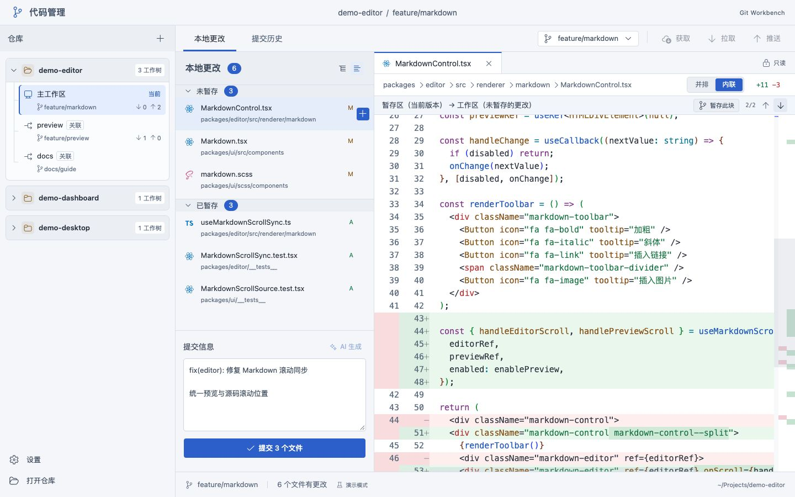
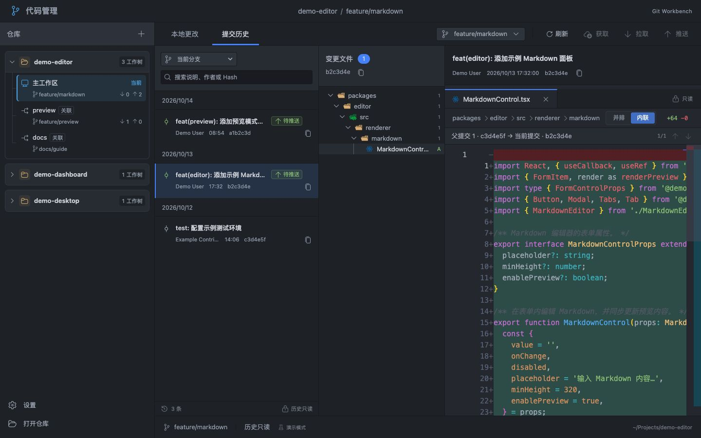

<p align="center">
  
</p>

<h1 align="center">Git Workbench · 代码管理</h1>

<p align="center">
  <strong>把本地 Git 工作，集中在一个桌面工作台。</strong><br>
  查看修改、管理 worktree、准备提交，在同一个窗口中完成。
</p>

<p align="center">
  <a href="https://github.com/asd116725/git-workbench/releases/latest"></a>
  
  <a href="LICENSE"></a>
</p>

<p align="center">
  <a href="https://github.com/asd116725/git-workbench/releases/latest"><strong>下载 macOS 版</strong></a> ·
  <a href="docs/zh-CN/user-manual.md">操作手册</a> ·
  <a href="CHANGELOG.zh-CN.md">版本更新</a> ·
  <a href="https://github.com/asd116725/git-workbench/issues">问题反馈</a>
</p>

<p align="center"><a href="README.md">English</a> · <strong>简体中文</strong></p>

Git Workbench 将本地仓库、关联 worktree、分支、Diff 和提交历史放在同一个桌面应用中。适合同时维护多个项目、并行处理功能分支，并希望在提交前逐项核对修改的开发者。

应用沿用本机 Git 的作者信息、签名、hooks 和远程凭据配置。你也可以选择接入 DeepSeek，根据暂存修改和当前界面语言生成提交草稿，检查后再使用。



*v1.8.0 浅色界面预览，使用虚构演示数据。截图中的按变更块暂存属于浏览器演示，桌面应用当前支持文件、目录与整组暂存，详见[支持范围与限制](#支持范围与限制)。*

## 日常 Git 工作，在这里完成

| 工作场景 | 可以做什么 |
| --- | --- |
| **仓库与 worktree** | 打开已有本地仓库，发现关联 worktree，从侧栏切换并行工作区；重新打开应用时恢复仓库与上次选中的工作区。 |
| **Diff 与暂存** | 用目录树或列表浏览修改，查看并排或内联 Diff，暂存或取消暂存文件、目录及整组变更；确认后可撤销单个或全部未暂存修改；也可提交暂存内容，保留未暂存修改。 |
| **分支与远程同步** | 搜索、创建、删除及合并分支，获取、拉取、推送或首次发布分支；在侧栏、分支列表与工具栏查看待拉取、待推送数量。 |
| **提交历史** | 同时浏览提交列表、变更文件与历史 Diff，搜索所选分支的完整可达历史，切换合并父提交，识别尚未推送的记录。 |
| **AI 提交草稿** | 使用 DeepSeek 根据暂存修改和当前界面语言生成 Conventional Commit；先预览编辑，再明确填入提交草稿。 |
| **阅读与操作体验** | 调整分栏宽度、字号和 Diff 模式，可选择浅色、深色或跟随系统外观，保留文件类型图标；支持 English、简体中文、繁體中文。 |

切换到有远程上游的分支时，应用会检查更新并尝试快进拉取。如果本地修改、分支分叉或网络错误阻止同步，会保留已经完成的切换并说明原因。合并冲突需在外部编辑器中解决，再回到应用完成合并；也可以在应用中中止合并。

**1.8.0** 起，可在 **设置 → 外观主题** 选择「浅色 / 深色 / 跟随系统」。工作台、代码区和原生窗口同步切换，并自动记住选择；当前工作区、Diff 阅读位置和提交草稿保持不变。

### 从一条提交，追到具体修改

选中提交即可查看完整信息、变更文件与 Diff。历史中的分支筛选只改变浏览范围，不切换当前工作分支。



*v1.8.0 深色提交历史预览，仓库、路径、作者和提交记录均为虚构数据。*

## AI 提交信息，先检查再使用

AI 文案功能自 **1.7.0** 起提供，使用 DeepSeek 与 `staged-commit-message-zh` 写作规则。生成语言跟随「设置 → 界面语言」：中文简体生成简体中文，中文繁體生成繁体中文，English 生成英文。每次生成或重新生成时读取当前选择；切换语言不会翻译或覆盖已有草稿和候选文案。

1. **暂存本次修改**，明确希望纳入提交的内容。
2. 点击 **AI 生成**，在弹窗中检查并编辑候选文案。
3. 点击 **使用此文案** 或 **替换草稿**，回到提交框再次确认，再手动提交。

生成过程不会暂存文件、提交或推送。取消或失败时保留原草稿；暂存内容、HEAD 或分支变化后，旧候选会失效。

**配置与数据范围**：在本地环境中配置 `DEEPSEEK_API_KEY`，由原生进程读取，不保存到前端偏好或安装包中。发起生成时，暂存差异、必要的索引上下文、提交规范与近期提交标题会发送至 DeepSeek；未暂存修改和无关未跟踪文件不会发送。AI 功能需要 DeepSeek 账户与网络，手写提交流程始终可用。

[查看 AI 配置、支持范围与排错说明 →](docs/zh-CN/user-manual.md#ai-生成提交信息170)

## 安装与快速上手

当前正式版本为 **1.9.0**，提供 **macOS Apple Silicon（arm64）** 安装包。

| 下载内容 | 链接 |
| --- | --- |
| macOS 安装包 | [GitWorkbench_1.9.0_macos_arm64.dmg](https://github.com/asd116725/git-workbench/releases/download/v1.9.0/GitWorkbench_1.9.0_macos_arm64.dmg) |
| SHA-256 校验文件 | [SHA256SUMS.txt](https://github.com/asd116725/git-workbench/releases/download/v1.9.0/SHA256SUMS.txt) |
| 版本说明 | [v1.9.0 更新内容](https://github.com/asd116725/git-workbench/releases/tag/v1.9.0) |

1. **安装应用**：使用同一 Release 的校验文件核对 DMG，将「代码管理」拖入 Applications。详见[安装说明](docs/zh-CN/installation.md)。
2. **打开仓库**：先确认 `git --version` 可以运行，再点击应用中的「打开仓库」，选择已有的本地仓库。
3. **查看并暂存**：选择文件阅读 Diff，通过行末或分组操作暂存本次需要提交的修改。
4. **提交并同步**：手写提交信息或选择 AI 草稿，确认提交后，再按需获取、拉取或推送。

安装包采用 **ad-hoc 签名，未进行 Apple Developer ID 签名或公证**。macOS 提示处理见[首次打开](docs/zh-CN/installation.md#首次打开)。Intel Mac、Windows、Linux 暂无官方安装包；构建目标为 macOS 12 及以上，尚未覆盖所有旧系统版本的兼容性验证。

## 支持范围与限制

- **已有仓库**：打开本机已经存在的仓库；克隆与初始化在应用之外完成。
- **桌面暂存**：支持文件、目录及整组暂存，暂不支持按变更块暂存或在应用内编辑冲突；请在编辑器中解决冲突。
- **提交草稿**：仅保留在当前应用会话中，使用 `⌘Q` 退出或升级前请先保存。仓库路径、布局与语言偏好会在下次启动时恢复。
- **远程状态**：数量基于本地已获取的上游引用，点击「获取」可更新。没有上游时显示「发布分支」，不会把整段提交历史算作待推送。
- **Diff 范围**：二进制文件、非 UTF-8 文本、超过 2 MiB 的文件、子模块及未解决冲突可能显示说明，而不是普通文本 Diff。
- **更新方式**：从 [GitHub Releases](https://github.com/asd116725/git-workbench/releases) 手动下载新版本，暂不提供自动更新。

<details>
<summary>桌面应用与浏览器演示的功能对照</summary>

| 功能 | 桌面应用 | 浏览器演示 |
| --- | --- | --- |
| 本地仓库、worktree 与分支切换 | 真实 Git 操作 | 虚构数据 |
| 创建与删除分支 | 真实 Git 操作 | 内存演示 |
| 文件 Diff、暂存与提交 | 真实 Git 操作 | 内存演示 |
| 提交历史、分支筛选与历史 Diff | 真实 Git 数据 | 虚构数据 |
| 获取、拉取、推送与分支合并 | 真实 Git 操作 | 暂未提供 |
| DeepSeek 提交文案生成 | 可选，使用本机 API Key | 暂未提供 |
| 按变更块暂存 | 暂未提供 | 仅演示 |
| 冲突编辑 | 暂未提供 | 暂未提供 |

</details>

<details>
<summary>刷新与会话行为</summary>

当前工作区通过文件监听自动刷新：最后一次变化后等待 1 秒，前台空闲时读取；每次自动刷新结束后至少间隔 5 秒。后台变化回到前台后合并处理，刷新会保留阅读位置与当前提交草稿，也可点击「刷新」立即读取。

macOS 红色关闭按钮只隐藏窗口，进程仍在运行，点击 Dock 图标即可恢复。完全退出会结束会话并清除提交草稿。不可用的仓库路径会提示错误，不会阻止其他仓库恢复。

提交历史每页 50 条，搜索覆盖所选分支的完整可达历史。发现新提交后会提示手动刷新，保留正在阅读的 Diff。

</details>

## 技术构成

使用 **Tauri 2 + Rust** 构建桌面壳与 Git 集成，使用 **React + TypeScript** 构建界面，通过 **Monaco Editor + Shiki** 展示 Diff 与语法高亮。仓库操作由本机安装的 Git 执行。

### 从源码启动

需要 Node.js **22.14+（同一主版本 22）**、pnpm **11.17.0**、Rust **1.99.0**（仓库工具链自动选择）及 Git。macOS 桌面构建还需要 Xcode Command Line Tools：`xcode-select --install`。

```sh
git clone https://github.com/asd116725/git-workbench.git
cd git-workbench
pnpm install --frozen-lockfile
pnpm desktop
```

只预览界面可运行 `pnpm dev`，访问终端给出的本地地址。浏览器模式使用独立演示数据，不会操作本机仓库。

<details>
<summary>开发检查与打包命令</summary>

```sh
pnpm typecheck
pnpm lint
pnpm test
pnpm build
cargo fmt --manifest-path src-tauri/Cargo.toml -- --check
cargo test --locked --manifest-path src-tauri/Cargo.toml
pnpm release:check --tag v1.9.0
```

```sh
# 仅生成 .app
pnpm desktop:build

# 生成 arm64 DMG、校验文件与发布说明（需要 macOS）
pnpm desktop:package
```

`.app` 位于 `src-tauri/target/release/bundle/macos/`，标准化发布文件位于 `release-artifacts/`。版本维护和 GitHub Actions 流程见[发布指南](docs/zh-CN/releasing.md)。

</details>

## 文档与参与

| 想了解什么 | 从这里开始 |
| --- | --- |
| 日常 Git 操作流程 | [操作手册](docs/zh-CN/user-manual.md) |
| 安装、更新与 macOS 提示 | [安装说明](docs/zh-CN/installation.md) |
| 各版本更新内容 | [更新日志](CHANGELOG.zh-CN.md) |
| Bug 与功能建议 | [GitHub Issues](https://github.com/asd116725/git-workbench/issues) |
| 贡献代码或文档 | [贡献指南](CONTRIBUTING.zh-CN.md) |
| 准备发布版本 | [维护者发布指南](docs/zh-CN/releasing.md) |

## 许可证

项目代码采用 [MIT](LICENSE) 许可证。Codicons、vscode-icons、Geist 字体、Atom One Dark、One Light 主题及第三方软件保留各自许可证，详见[第三方许可说明](THIRD-PARTY-NOTICES.zh-CN.md)。应用包中附带许可副本。
