# Git Workbench visual feature guide

**English** · [简体中文](zh-CN/feature-guide.md) · [Back to the homepage](../README.md) · [User manual](user-manual.md)

Explore 20 feature workflows in the v1.10.0 desktop app. Examples use the fictional `orbit-web` and `orbit-api` projects, with a real local bare repository as the offline `origin`. Screenshots use the English interface.

Every image is a real desktop capture. Captions identify previews, canceled actions, and completed operations.

1. [Open a local repository](#open-repository)
2. [Switch between worktrees](#switch-worktree)
3. [Rename projects and worktrees](#custom-names)
4. [Reorder the sidebar](#sidebar-order)
5. [Browse a file tree or flat list](#file-tree-list)
6. [Read inline and side-by-side diffs](#diff-views)
7. [Stage and unstage changes](#stage-unstage)
8. [Discard unstaged changes](#discard-unstaged)
9. [Write and create a commit](#manual-commit)
10. [Generate and review AI commit drafts](#ai-draft-setup)
11. [Browse commits and historical diffs](#browse-history)
12. [Search and filter commit history](#search-filter-history)
13. [Search and switch branches](#switch-branch)
14. [Create a local branch](#create-branch)
15. [Delete a local branch](#delete-branch)
16. [Merge branches](#merge-branch)
17. [Fetch and pull updates](#fetch-pull)
18. [Push or publish a branch](#push-publish)
19. [Choose appearance and language](#appearance-language)
20. [Adjust layout and refresh state](#layout-refresh)

## 1. Open a local repository

Bring an existing project into one desktop workspace.

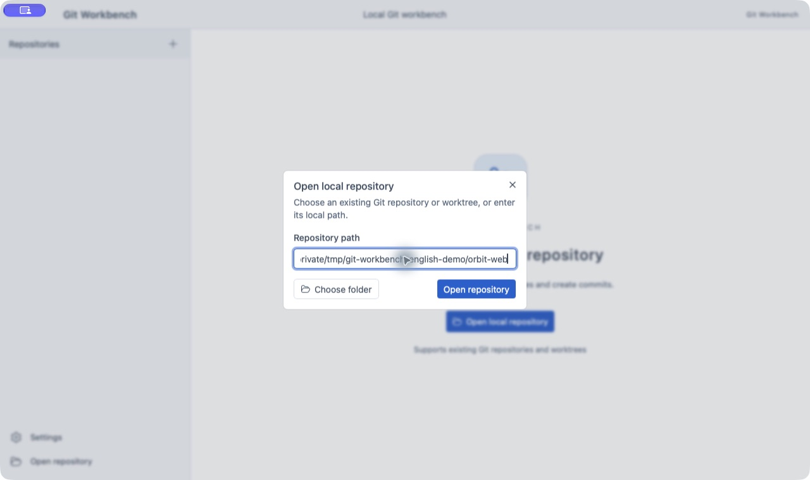

The open-repository form has the local `orbit-web` path entered, ready to open.

1. Click **Open repository** or the `+` beside the repository heading.
2. Choose an existing repository directory, or enter its path.
3. Select the project in the sidebar and check the active path in the bottom bar.

Repository paths are remembered on this device. Clone or initialize a repository with Git or another tool before opening it here.

## 2. Switch between worktrees

Move between parallel work without mixing their files or staged changes.

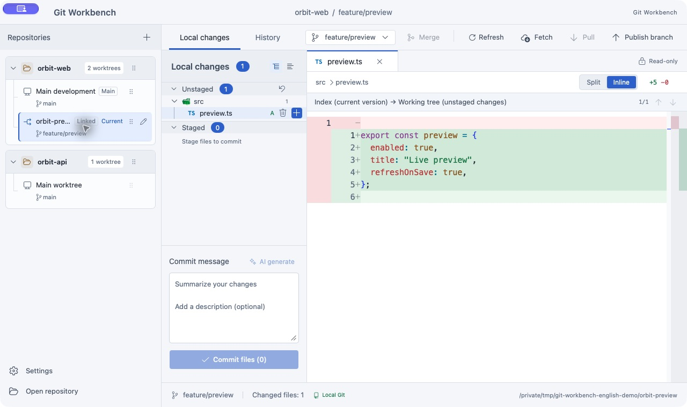

The linked `feature/preview` worktree is selected, with its own `src/preview.ts` change visible.

1. Expand a project using the arrow beside its name.
2. Click its main worktree or a linked worktree.
3. Check the **Current** marker, branch, and path before staging or committing.

Each worktree has its own files, index, and session draft. Creating, deleting, or repairing worktrees requires Git or another tool; the app discovers registered worktrees.

## 3. Rename projects and worktrees

Give projects, main worktrees, and linked worktrees names that match how you use them.

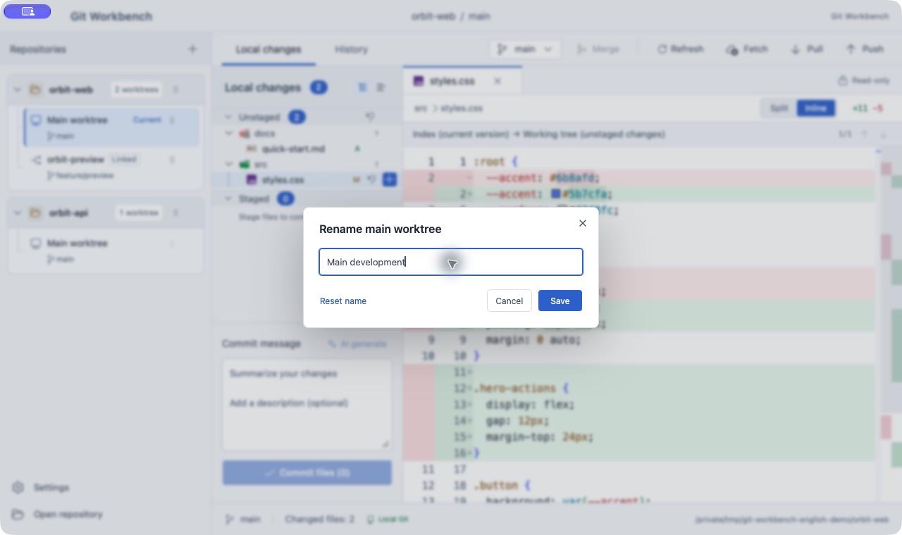

`Main development` is entered in **Rename main worktree**; this image is captured before **Save**.

1. Hover over a row or use `Tab` to focus **Rename project**, **Rename main worktree**, or **Rename worktree**.
2. Enter a nonempty display name, then click **Save** or press `Enter`.
3. To restore the original name, choose **Reset name**, then **Save**; **Cancel** or `Esc` leaves the saved name unchanged.

Names persist on this device. They do not rename directories or Git branches, move repositories, or change files.

## 4. Reorder the sidebar

Keep active projects and worktrees close at hand.

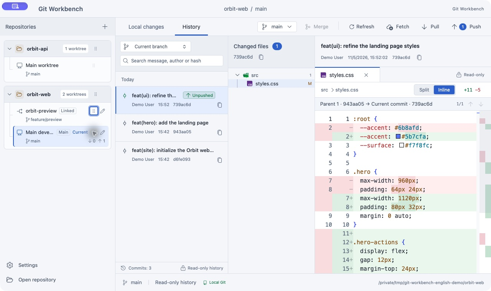

After keyboard reordering, `orbit-api` is first and `orbit-preview` precedes the main worktree. The worktree handle remains focused.

1. Drag a project's handle to move its entire group.
2. Drag a worktree's handle to reorder it within the same project, or focus a handle with `Tab` and press `↑` / `↓`.
3. Drop at the insertion line to keep the new order; press `Esc` to cancel a drag.

The main worktree can move from the first position. Worktrees cannot move between projects. Orders survive restarts, and new entries append to their lists.

## 5. Browse a file tree or flat list

Find changed files by folder or scan them in one list.

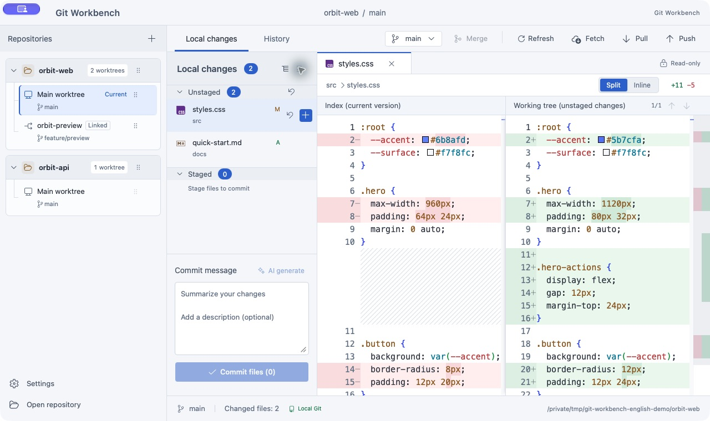

List view shows `src/styles.css` and `docs/quick-start.md` as two unstaged files.

1. Use the view buttons at the top right of the changes pane to choose a tree or list.
2. In tree view, use folder arrows to expand or collapse directories.
3. Click a file name to inspect its diff; check the breadcrumb for its full relative path.

Changes are grouped into **Unstaged** and **Staged**. A partially staged file can appear in both groups. Folder arrows navigate the tree; row-end actions stage or unstage files.

## 6. Read inline and side-by-side diffs

Compare before and after content before deciding what to commit.

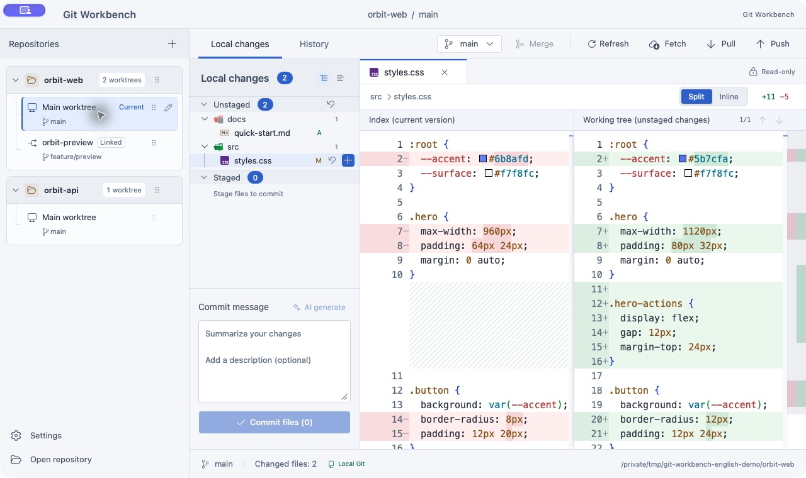

**Split** compares the index and working copy of `src/styles.css`; **Inline** remains available beside it.

1. Select an unstaged file to compare **index → worktree**, or a staged file to compare **HEAD → index**.
2. Choose **Inline** or **Split** above the diff.
3. Use the previous/next change arrows to navigate additions and deletions.

Diffs are read-only; edit files in your editor. Change navigation does not stage individual hunks. Binary files, non-UTF-8 text, files over 2 MiB, submodules, and unresolved conflicts may show an explanation instead of text.

## 7. Stage and unstage changes

Build a commit from the files you intend to include.

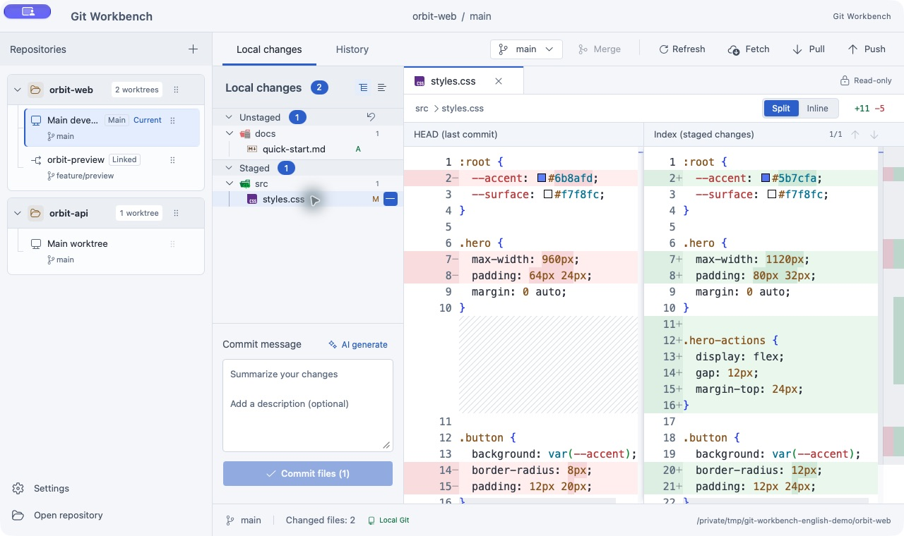

`src/styles.css` is staged, while `docs/quick-start.md` remains unstaged. The staged file has a visible `−` action.

1. Hover over a file in **Unstaged** and click `+` to stage it.
2. Use a directory or group heading's `+` to stage its listed files together, including files in collapsed subdirectories.
3. In **Staged**, use the corresponding `−` to unstage a file, directory, or group, then review the staged diff.

Unstaging keeps worktree file content. Desktop staging operates on whole files, including when selected through a directory or group; individual-hunk staging is not supported.

## 8. Discard unstaged changes

Remove unwanted working edits while preserving staged content.

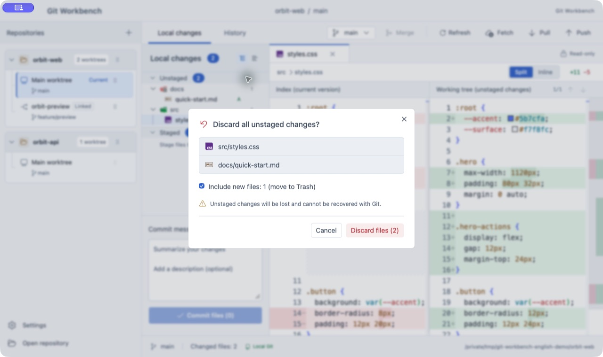

The confirmation lists two files and includes the new file by default. The preview was canceled; no changes were discarded.

1. In **Unstaged**, use a file's discard button or the group action for all unstaged changes.
2. Review the affected files. New untracked files are included by default; clear their checkbox to keep them.
3. Confirm only after checking the scope, or choose **Cancel** to keep everything.

Tracked files return to their index version; selected untracked files move to the system Trash. Discarded unstaged edits cannot be recovered through Git. If the preview becomes outdated, reread it before confirming.

## 9. Write and create a commit

Record the staged changes with a message you control.

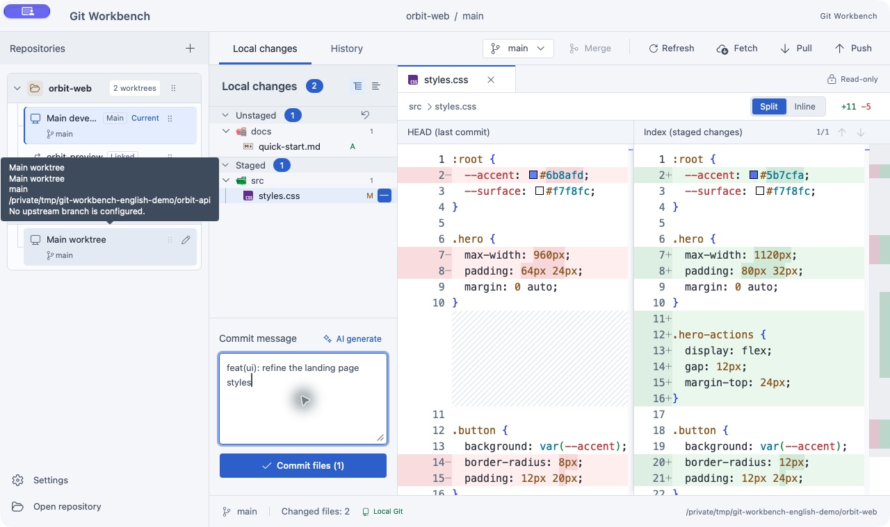

The message is ready for **Commit files (1)**. The app subsequently created the example commit `739ac6d`.

1. Review the files and diffs in **Staged**.
2. Write a subject on the first line of the commit field; add a body on later lines if needed.
3. Click **Commit files (N)** or press `⌘ Enter` in the form.

Only staged content is committed; other edits remain. The app uses your Git author, signing, and hooks settings. Failed checks preserve the draft; a successful commit clears it. Drafts last only for the current app session.

## 10. Generate and review AI commit drafts

Optionally turn staged changes into a draft that you review before committing.

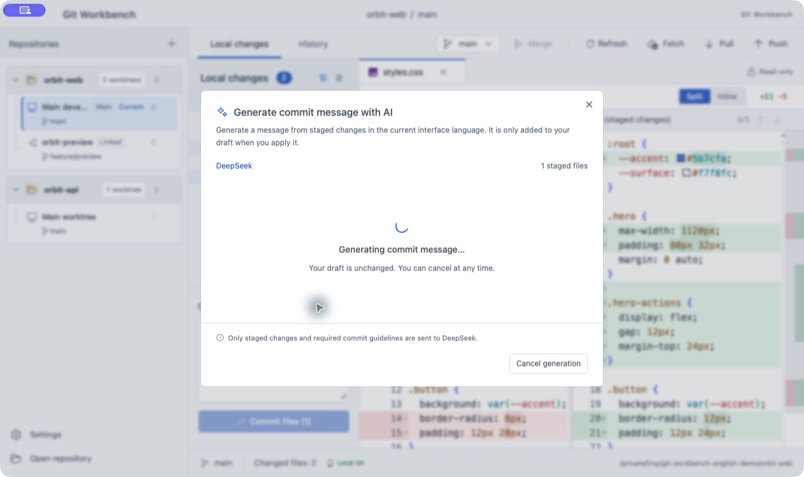

A request is generating a message for one staged file. **Cancel generation** is available, and no candidate is shown.

1. Review the staged files and data scope below, then click **AI generate**. If a key is configured, generation starts automatically after the key check.
2. Wait for the candidate, or choose **Cancel generation** to keep your existing draft.
3. After a successful request, review and edit the candidate, choose **Use this message** or **Replace draft**, then commit manually.

The screenshot captures generation in progress. The request was canceled without applying a result or creating a commit; it does not show a successful candidate.

If no key is detected, configure `DEEPSEEK_API_KEY` in the app's launch environment and choose **Check again**. A successful recheck shows **Generate**, which starts the request. Detecting a key does not verify authentication or balance.

Generation sends staged diffs, necessary index context, commit conventions, and recent commit titles to DeepSeek. It requires a DeepSeek account and network access. Canceling or failing preserves the existing draft. [AI setup and limits →](user-manual.md#ai-generated-commit-messages-170)

## 11. Browse commits and historical diffs

Follow a recorded change from its commit message to the affected lines.

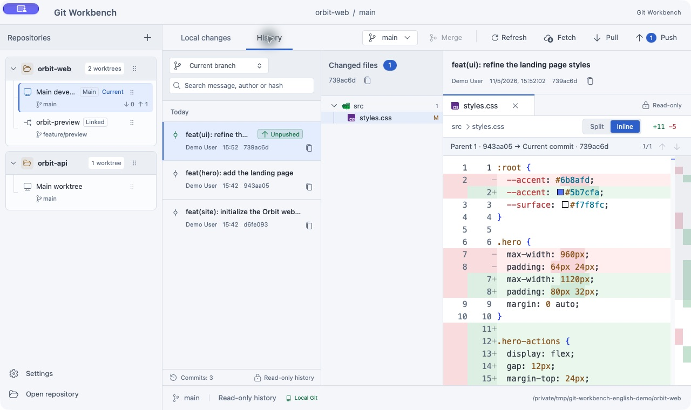

Example commit `739ac6d` is selected with its **Unpushed** badge and the historical diff for `src/styles.css`.

1. Open **History** from the top bar.
2. Select a commit, then a file in its changed-file tree.
3. Read the historical diff; for a merge commit, choose a parent to change the comparison.

History is read-only and uses content stored in Git, not the current working files. It does not offer revert, cherry-pick, or history rewriting. Use **Load more** to browse older commits.

## 12. Search and filter commit history

Find a change across the complete history reachable from a selected branch.

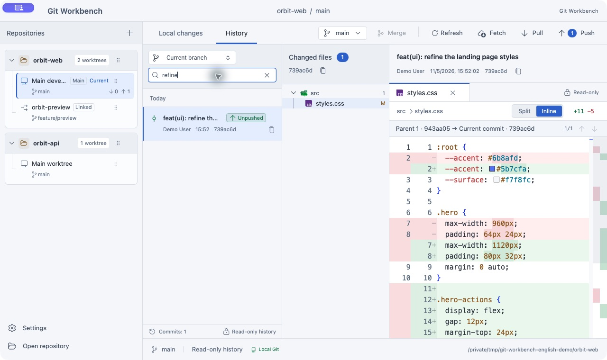

Searching `refine` returns one commit. The branch filter remains **Current branch**.

1. Keep **Current branch**, or choose a local or fetched remote branch in the history filter.
2. Enter part of a subject, body, author name, email, or full hash in the search field.
3. Select a result to inspect its changed files and diff.

Filtering history does not switch the worktree branch. Search covers the selected branch's full reachable history, not only loaded pages. **Unpushed** markers, when available, use the selected local branch's fetched upstream refs.

## 13. Search and switch branches

Choose the branch for the active worktree without leaving the app.

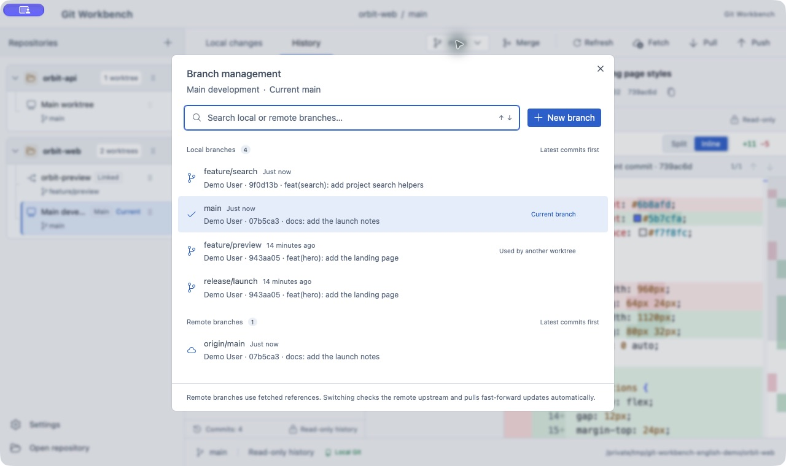

The list includes `main`, `feature/search`, and `release/launch`; `feature/preview` is marked **Used by another worktree**.

1. Click the current branch in the top bar to open **Branch management**.
2. Type to filter local and fetched remote branches, then select a branch or use `↑` / `↓` and `Enter`.
3. Check the active branch and any synchronization message after switching.

Branches used by another worktree cannot be selected. Switching to a branch with a remote upstream checks for updates and attempts a fast-forward pull. Local edits or divergent history may require attention; the app does not automatically stash them.

## 14. Create a local branch

Start a new line of work from a chosen commit or branch.

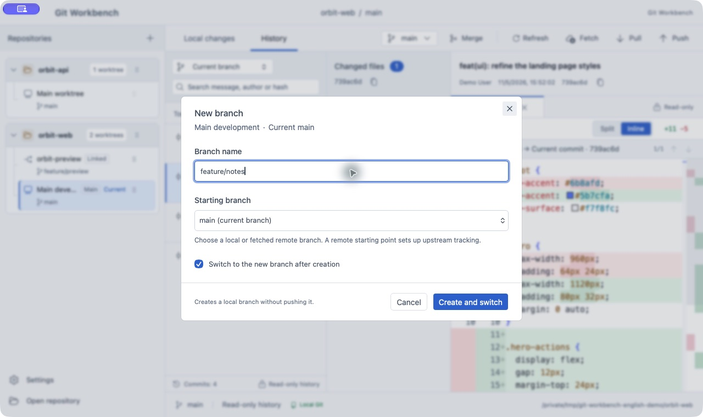

`feature/notes` is entered with **Create and switch** selected. This form was canceled; the branch was not created.

1. Open **Branch management → New branch** and enter a branch name.
2. Choose its starting point; keep or clear **Switch to the new branch after creation**.
3. Choose **Create and switch** or **Create branch**.

A remote starting point establishes upstream tracking but does not push. Git rejects invalid or duplicate names. If creation succeeds but switching fails, the new branch remains available; resolve the error and switch to it without recreating it.

## 15. Delete a local branch

Remove a local branch reference after checking its remaining commits.

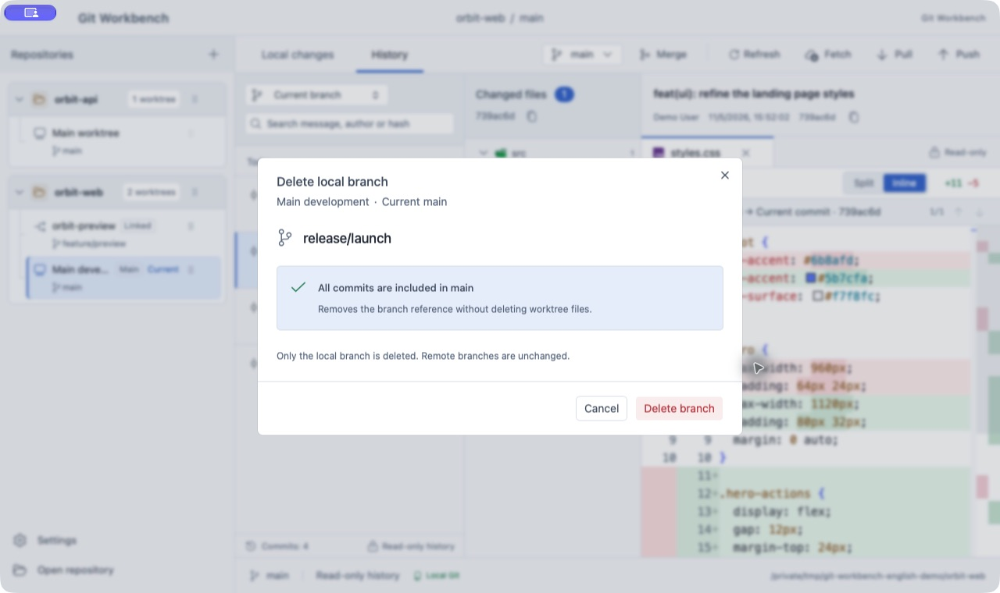

`release/launch` is fully included in `main`. This deletion preview was canceled; the branch was kept.

1. In **Branch management**, hover over an unused local branch and choose its delete action.
2. Review the branch name and whether its commits are included in the current HEAD.
3. Confirm deletion, or cancel. An unmerged branch requires explicit acknowledgment before force deletion is available.

The current branch and branches used by any worktree cannot be deleted here. Deleting removes only the local reference, not worktree files or the remote branch. Pushed commits are not necessarily merged into the current HEAD.

## 16. Merge branches

Bring another branch's committed changes into the current branch.

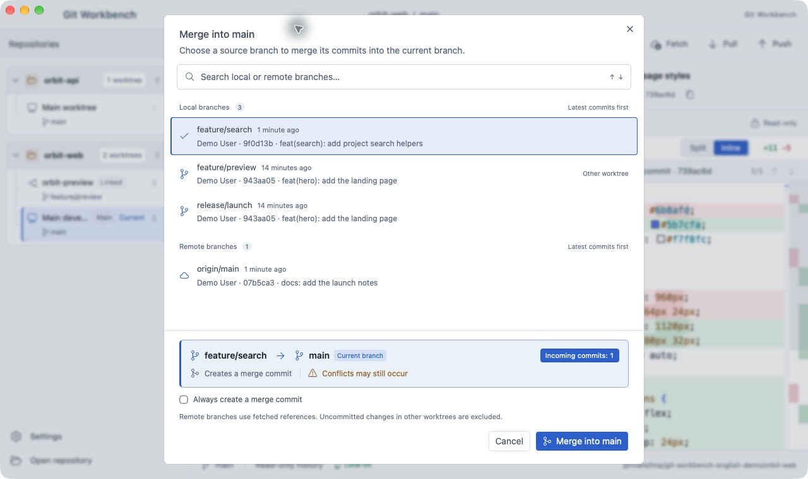

`feature/search → main` has one incoming commit and would create a merge commit. The preview was canceled; no merge ran.

1. Select the receiving worktree and branch, with a clean worktree and index, then click **Merge**.
2. Choose the source branch and review **source → current branch** and the incoming commit count.
3. Keep the default fast-forward-when-possible behavior, or choose **Always create a merge commit**, then confirm.

If conflicts occur, resolve files in your editor, stage them, and return to **Complete merge**. **Abort merge** can abandon an unfinished merge after confirmation. The app has no built-in conflict editor. [Merge and recovery details →](user-manual.md#41-merging-branches)

## 17. Fetch and pull updates

Inspect remote changes before bringing them into your branch.

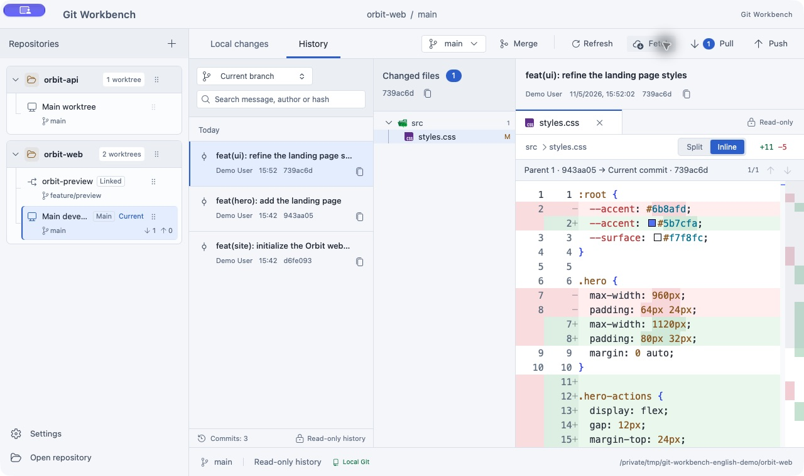

After **Fetch**, `main` shows one incoming commit. A subsequent **Pull** completed against the local offline remote.

1. Select a worktree with a configured remote, then click **Fetch**.
2. Check the incoming count against the branch's upstream.
3. Click **Pull** to fetch that upstream and update the branch by fast-forward.

Fetch updates remote refs without merging into working files. Pull requires an upstream; divergent histories need a merge before retrying. Counts use locally fetched refs. These examples use a real local bare repository as an offline remote, not a hosted service.

## 18. Push or publish a branch

Send the current branch's commits to its remote target.

`main` has one outgoing commit before **Push**. The subsequent push to the local offline remote succeeded.

1. Commit the intended changes and confirm the current branch.
2. With an upstream, use **Push**; without one, use **Publish branch**.
3. If asked, choose the remote, then verify the upstream and refreshed synchronization status.

First publication prefers `origin`, otherwise the only remote; ambiguous targets require a selection. The app pushes only the current branch and does not force-push. Remote access uses your existing Git credentials and SSH configuration.

## 19. Choose appearance and language

Make the interface comfortable to read in your preferred language.

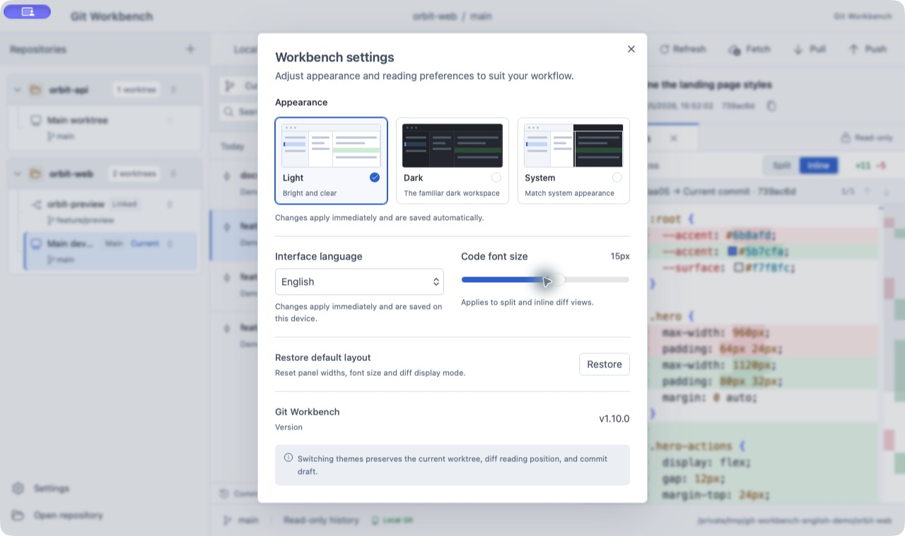

**Light** and **English** are selected; the existing code font size is **15px**.

1. Open **Settings** at the bottom left.
2. Under **Appearance**, choose **Light**, **Dark**, or **System**.
3. Under **Interface language**, choose **English**, **中文简体**, or **中文繁體**.

Selections apply immediately and survive restarts. Theme changes preserve the worktree, diff position, and draft. Changing language does not translate repository content or existing commit messages; future AI generation follows the selected interface language.

## 20. Adjust layout and refresh state

Keep code readable and inspect the latest state of your worktree.

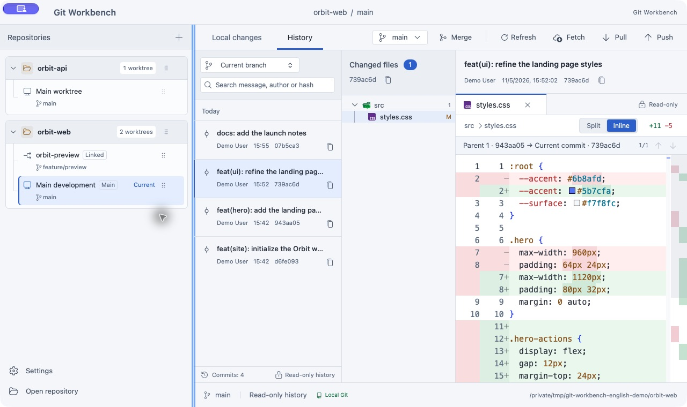

The sidebar was widened with the focused divider and `→`. The **Refresh** action remains in the top bar.

1. Drag pane dividers to adjust the sidebar, changes list, or history columns; focused dividers also respond to `←` / `→`.
2. Change **Code font size** in **Settings**; click **Restore** under **Restore default layout** to reset widths, font size, and diff mode.
3. Use **Refresh** in the top bar for an immediate reread of the current view.

Layout and reading preferences persist. File watching also refreshes local state while the app is in the foreground and idle; remote refs require **Fetch**. In history, a new-commit notice lets you refresh without interrupting the diff you are reading.

See the [installation guide](installation.md) for setup and updates, or the [user manual](user-manual.md) for troubleshooting and detailed limits.
