# Git Workbench 完整图文指南

[English](../feature-guide.md) · **简体中文** · [返回首页](../../README.zh-CN.md) · [操作手册](user-manual.md)

按 20 个功能入口了解 v1.10.0 桌面应用。示例采用虚构项目 `orbit-web` 与 `orbit-api`；同步使用真实本地 bare 仓库作为离线 `origin`。配图使用英文界面，操作文字提供中文对应名称。

图片均为原生应用实拍，图注注明预览、取消及已完成操作。

1. [打开本地仓库](#open-repository)
2. [切换工作树](#switch-worktree)
3. [自定义项目与工作树名称](#custom-names)
4. [调整侧栏顺序](#sidebar-order)
5. [切换文件树与列表](#file-tree-list)
6. [阅读内联与并排 Diff](#diff-views)
7. [暂存与取消暂存](#stage-unstage)
8. [撤销未暂存修改](#discard-unstaged)
9. [手写信息并提交](#manual-commit)
10. [生成与审核 AI 提交草稿](#ai-draft-setup)
11. [浏览提交与历史 Diff](#browse-history)
12. [搜索与筛选提交历史](#search-filter-history)
13. [搜索与切换分支](#switch-branch)
14. [创建本地分支](#create-branch)
15. [删除本地分支](#delete-branch)
16. [合并分支](#merge-branch)
17. [获取与拉取更新](#fetch-pull)
18. [推送与首次发布分支](#push-publish)
19. [选择外观与界面语言](#appearance-language)
20. [调整布局与刷新状态](#layout-refresh)

## 1. 打开本地仓库

把已有项目加入桌面工作台。

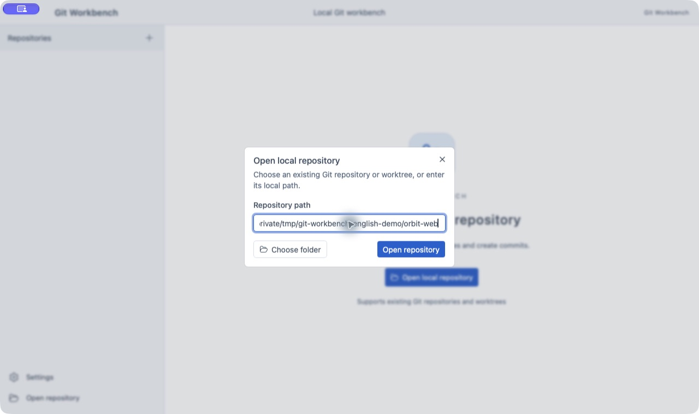

打开仓库表单已填入本地 `orbit-web` 路径，等待打开。

1. 点击 **Open repository（打开仓库）**，或仓库标题旁的 `+`。
2. 选择已有仓库目录，也可以输入完整路径。
3. 在侧栏选择项目，通过底部路径确认当前操作目标。

仓库路径会保存在当前设备。克隆或初始化仓库需先使用 Git 或其他工具完成。

## 2. 切换工作树

在并行任务之间切换，各工作树保留自己的文件与暂存内容。

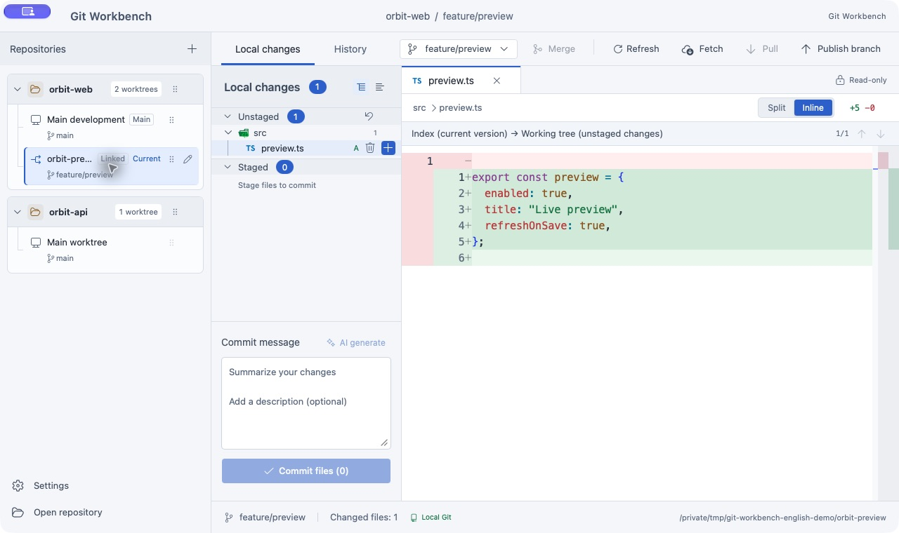

当前选中 `feature/preview` 关联工作树，显示其独立的 `src/preview.ts` 修改。

1. 点击项目名称旁的箭头，展开工作树列表。
2. 选择主工作区或标有 **Linked（关联）** 的工作树。
3. 暂存或提交前，核对 **Current（当前）** 标记、分支及路径。

每个工作树有独立文件、暂存区和会话草稿。应用发现 Git 已登记的工作树；创建、删除及修复工作树需使用 Git 或其他工具。

## 3. 自定义项目与工作树名称

为项目、主工作区和关联工作树设置便于识别的名称。

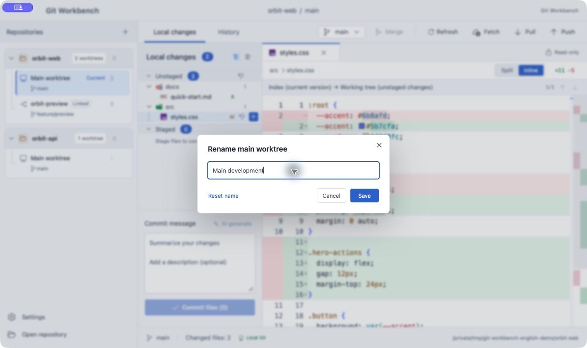

**Rename main worktree（修改主工作区名称）** 已输入 `Main development`，截图时尚未点击保存。

1. 悬停对应行，或用 `Tab` 聚焦 **Rename project / Rename main worktree / Rename worktree（修改项目、主工作区或工作树名称）**。
2. 输入非空名称，点击 **Save（保存）** 或按 `Enter`。
3. 需要还原时，点击 **Reset name（恢复默认）** 后再保存；取消或按 `Esc` 不会改变已保存名称。

名称保存在当前设备，重启后保留；不会重命名目录或 Git 分支，也不会移动仓库或修改文件。

## 4. 调整侧栏顺序

把常用项目和工作树放在容易找到的位置。

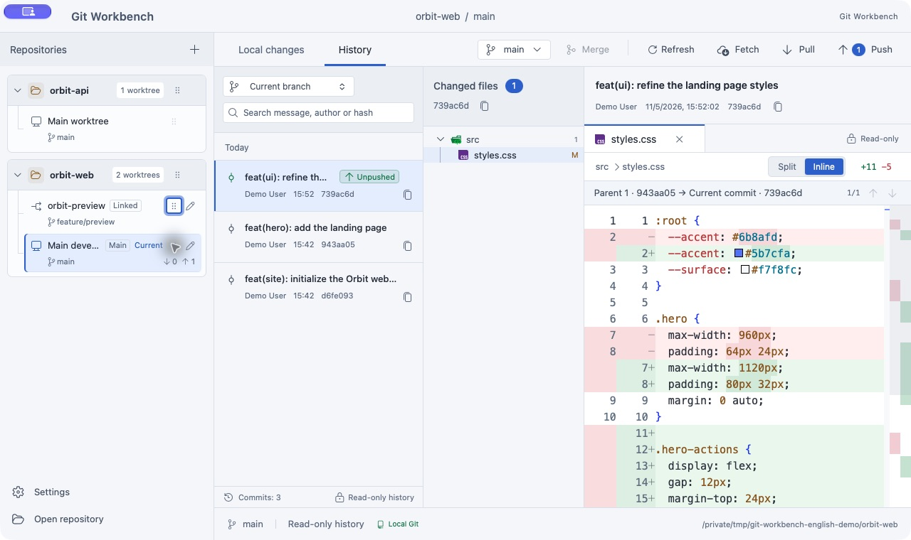

通过键盘排序后，`orbit-api` 位于首位，`orbit-preview` 位于主工作区之前；工作树排序手柄保持聚焦。

1. 拖动项目的排序手柄，移动整个项目组。
2. 拖动工作树手柄，在所属项目内排序；也可用 `Tab` 聚焦手柄，再按 `↑` / `↓`。
3. 在插入线位置松开以保留顺序，拖动中按 `Esc` 可取消。

主工作区也可以移出首位，工作树不能跨项目移动。顺序在重启后保留，新条目追加到各自列表末尾。

## 5. 切换文件树与列表

按目录定位修改，或通过平铺列表快速浏览文件。

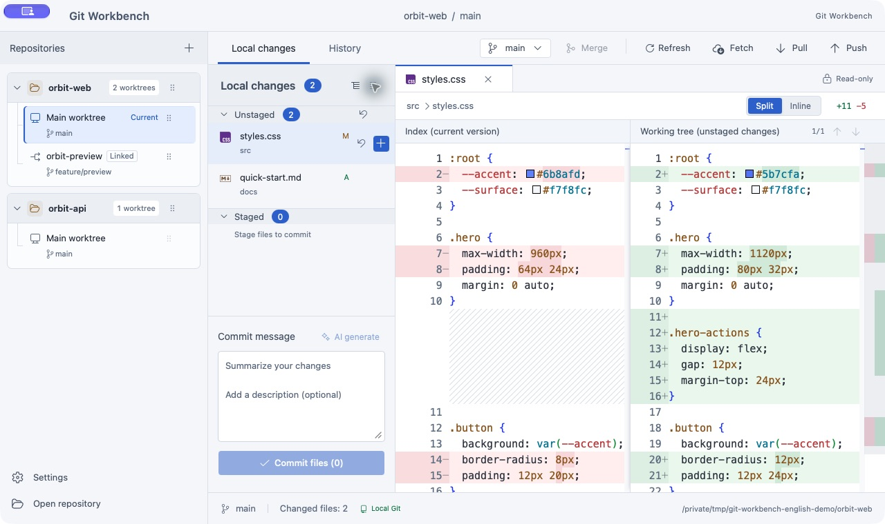

当前为列表模式，`src/styles.css` 与 `docs/quick-start.md` 均处于未暂存状态。

1. 使用变更面板右上角的视图按钮，切换目录树和列表。
2. 在树视图中，通过目录箭头展开或收起文件夹。
3. 点击文件名阅读 Diff，通过面包屑确认完整相对路径。

修改分为 **Unstaged（未暂存）** 和 **Staged（已暂存）**。部分暂存的文件可以同时出现在两组；目录箭头负责展开，行末按钮负责暂存或取消暂存。

## 6. 阅读内联与并排 Diff

比较修改前后的内容，再决定提交范围。

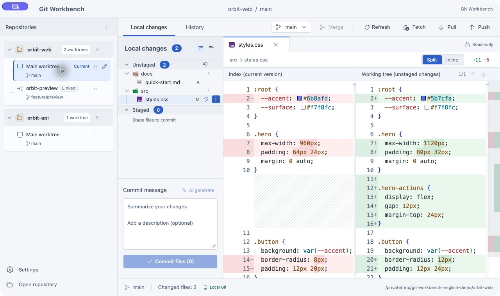

**Split（并排）** 正在对比 `src/styles.css` 的暂存区与工作文件，旁边可切换 **Inline（内联）**。

1. 选择未暂存文件，对比「暂存区 → 工作文件」；选择已暂存文件，对比「HEAD → 暂存区」。
2. 在 Diff 上方选择 **Inline（内联）** 或 **Split（并排）**。
3. 使用上一个、下一个变更箭头，定位新增与删除内容。

Diff 为只读，文件仍在编辑器中修改。跳转变更块不代表支持按块暂存；二进制、非 UTF-8、超过 2 MiB 的文件、子模块和未解决冲突可能显示说明。

## 7. 暂存与取消暂存

把本次需要提交的文件放入暂存区。

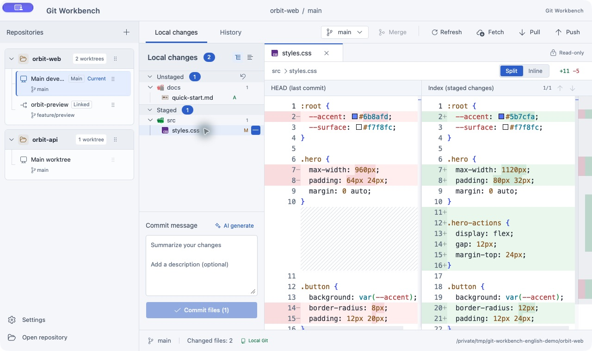

`src/styles.css` 已暂存，`docs/quick-start.md` 仍未暂存；已暂存文件行显示 `−` 操作。

1. 悬停 **Unstaged（未暂存）** 中的文件，点击 `+` 暂存。
2. 通过目录或分组标题的 `+` 一并暂存对应文件，包含折叠子目录中的变更。
3. 在 **Staged（已暂存）** 中使用对应的 `−`，取消暂存文件、目录或整组，再检查暂存 Diff。

取消暂存保留工作文件内容。桌面端按完整文件操作，目录和分组操作也是批量处理文件，暂不支持按变更块暂存。

## 8. 撤销未暂存修改

撤掉不需要的工作文件修改，保留已暂存内容。

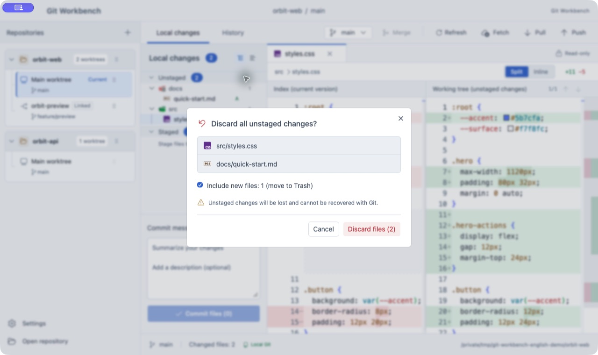

确认弹窗列出两个文件，默认包含新增文件。本次预览随后取消，没有撤销修改。

1. 在 **Unstaged（未暂存）** 中点击文件的撤销按钮，或通过分组按钮处理全部未暂存修改。
2. 检查影响文件；新增未跟踪文件默认包含在内，取消勾选可保留它们。
3. 确认范围后执行，或点击 **Cancel（取消）** 保留全部内容。

已跟踪文件恢复到暂存区版本，选中的未跟踪文件移到系统废纸篓。撤销的未暂存内容无法通过 Git 恢复；预览过期时需要重新读取再确认。

## 9. 手写信息并提交

用自己确认的提交信息记录暂存修改。

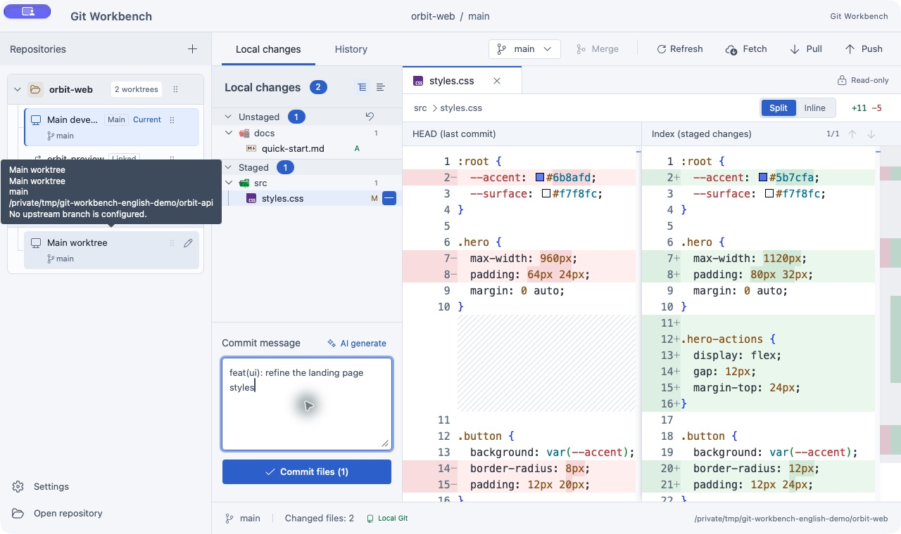

提交信息已填写，等待点击 **Commit files (1)**；应用随后实际创建了示例提交 `739ac6d`。

1. 检查 **Staged（已暂存）** 中的文件与 Diff。
2. 在提交框第一行填写标题，需要时在后续行补充说明。
3. 点击 **Commit files (N)（提交 N 个文件）**，或在表单中按 `⌘ Enter`。

仅提交暂存内容，其他编辑继续保留。应用沿用 Git 作者、签名和 hooks 配置；检查失败时保留草稿，提交成功后清空。草稿只保留在当前应用会话中。

## 10. 生成与审核 AI 提交草稿

可选地根据暂存修改生成草稿，由你审核后使用。

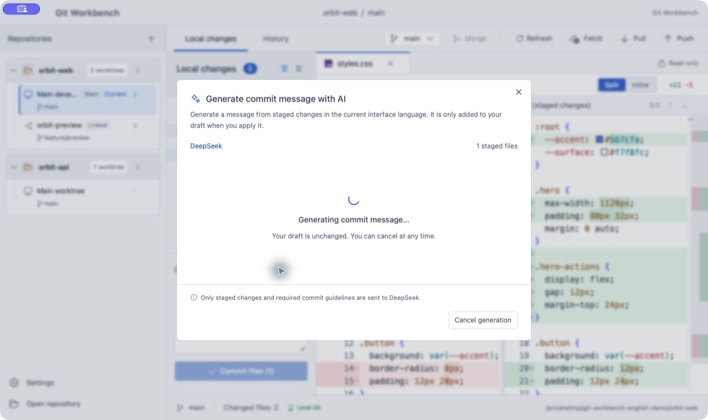

正在为一个暂存文件生成信息，可点击 **Cancel generation（取消生成）**，尚未显示候选文案。

1. 核对暂存文件与下述数据范围，点击 **AI generate（AI 生成）**；已有 Key 时，检查配置后会自动开始生成。
2. 等待候选，或点击 **Cancel generation（取消生成）** 保留已有草稿。
3. 请求成功后检查并编辑候选，点击 **Use this message / Replace draft（使用此文案 / 替换草稿）**，再手动提交。

配图为真实生成中的界面。本次请求随后已取消，未应用结果或创建提交，图片不代表候选已经生成成功。

如果没有检测到 Key，在应用启动环境中配置 `DEEPSEEK_API_KEY` 后点击 **Check again（重新检测）**。重新检测成功后显示 **Generate（开始生成）**，点击后发起请求。检测到 Key 不代表已通过鉴权或账户余额充足。

生成会将暂存差异、必要索引上下文、提交规范及近期提交标题发送至 DeepSeek，需要 DeepSeek 账户与网络。取消或失败时保留已有草稿。[配置与使用限制 →](user-manual.md#ai-生成提交信息170)

## 11. 浏览提交与历史 Diff

从提交说明追到变更文件与具体代码。

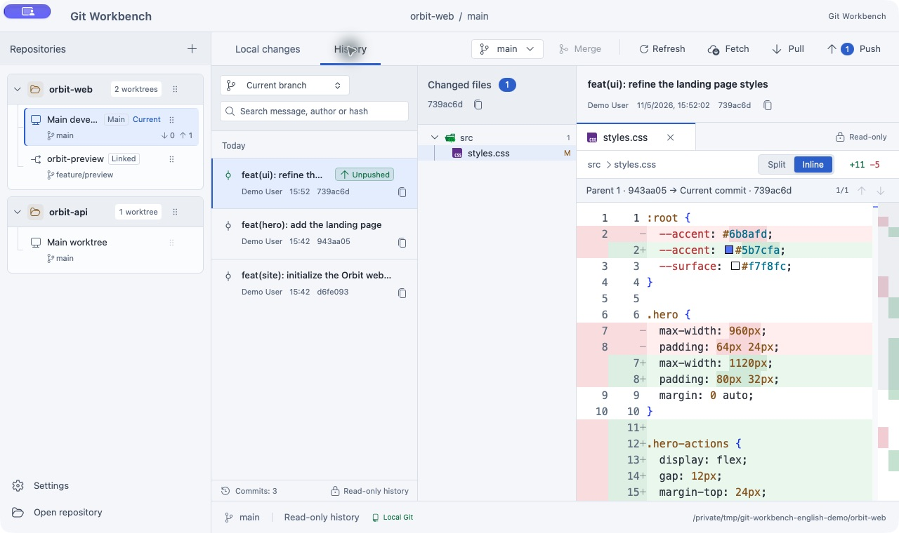

当前选中示例提交 `739ac6d`，显示 **Unpushed（待推送）** 标记与 `src/styles.css` 的历史 Diff。

1. 点击顶部 **History（提交历史）**。
2. 选择一条提交，再选择其变更文件树中的文件。
3. 阅读历史 Diff；合并提交可以切换父提交，改变比较基准。

历史为只读，正文来自 Git 对象，不取当前工作文件。此处不提供回退、拣选或历史改写；点击 **Load more（加载更多）** 可浏览更早记录。

## 12. 搜索与筛选提交历史

在指定分支的完整可达历史中寻找修改。

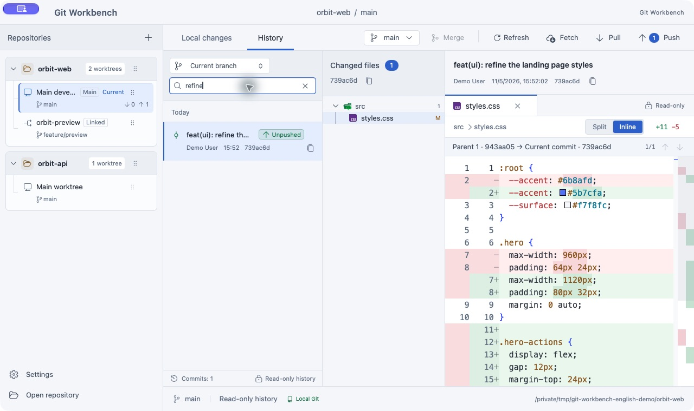

搜索 `refine` 后匹配一条提交，分支筛选仍为 **Current branch（当前分支）**。

1. 在历史分支筛选器中保留 **Current branch（当前分支）**，或选择本地分支及已获取的远程分支。
2. 输入提交标题、正文、作者姓名、邮箱或完整 Hash 中的部分内容。
3. 选择匹配结果，检查变更文件与 Diff。

历史筛选不会切换工作区分支。搜索覆盖所选分支的完整可达历史，不限于已加载页面；可用时显示的 **Unpushed（待推送）** 标记基于该本地分支已获取的上游引用。

## 13. 搜索与切换分支

直接为当前工作树选择要处理的分支。

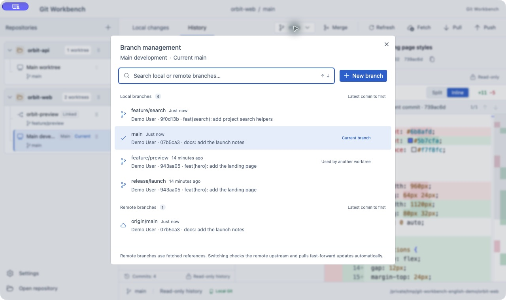

列表包含 `main`、`feature/search` 和 `release/launch`；`feature/preview` 标明 **Used by another worktree（其他工作树正在使用）**。

1. 点击顶部当前分支，打开 **Branch management（分支管理）**。
2. 输入关键词筛选本地及已获取的远程分支，点击选择，或用 `↑` / `↓` 和 `Enter` 操作。
3. 切换后检查当前分支和同步提示。

其他工作树正在使用的分支不能选中。切换到有远程上游的分支时，会检查更新并尝试快进拉取；本地修改或分支分叉可能需要先处理，应用不会自动 stash。

## 14. 创建本地分支

从指定起点开始一项新的分支任务。

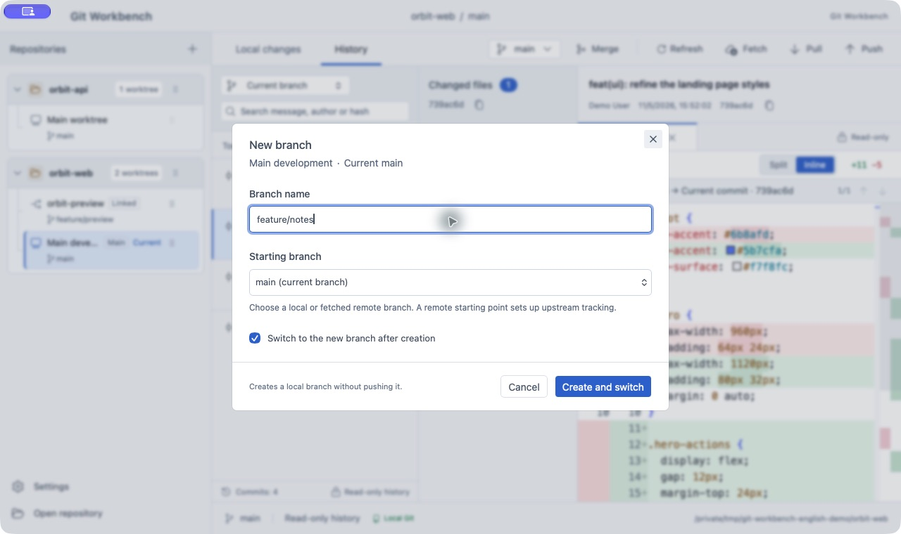

表单已填写 `feature/notes`，默认操作为 **Create and switch（创建并切换）**。本次随后取消，未创建分支。

1. 打开 **Branch management → New branch（分支管理 → 新建分支）**，填写名称。
2. 选择起点，按需保留或取消「创建后切换到新分支」。
3. 点击 **Create and switch / Create branch（创建并切换 / 创建分支）**。

远程起点会建立上游跟踪，但不会执行推送。Git 会拒绝非法或重复名称；如果创建成功而切换失败，分支仍会保留，处理错误后直接切换即可。

## 15. 删除本地分支

核对提交合入情况后，删除不再需要的本地分支引用。

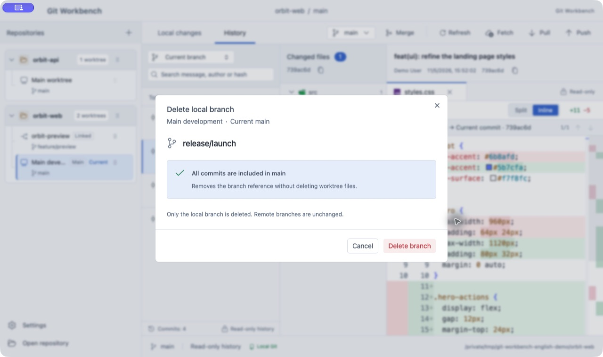

预览显示 `release/launch` 的提交已全部包含在 `main` 中。本次随后取消，分支保留。

1. 在 **Branch management（分支管理）** 中悬停未被使用的本地分支，点击删除按钮。
2. 检查分支名称，以及其提交是否已包含在当前 HEAD 中。
3. 确认删除或取消；存在未合入提交时，需要明确勾选风险确认后才能强制删除。

当前分支和任何工作树正在使用的分支不能在此删除。删除只移除本地引用，不删除工作文件或远程分支；已推送不等于已合入当前 HEAD。

## 16. 合并分支

把其他分支已提交的修改合入当前分支。

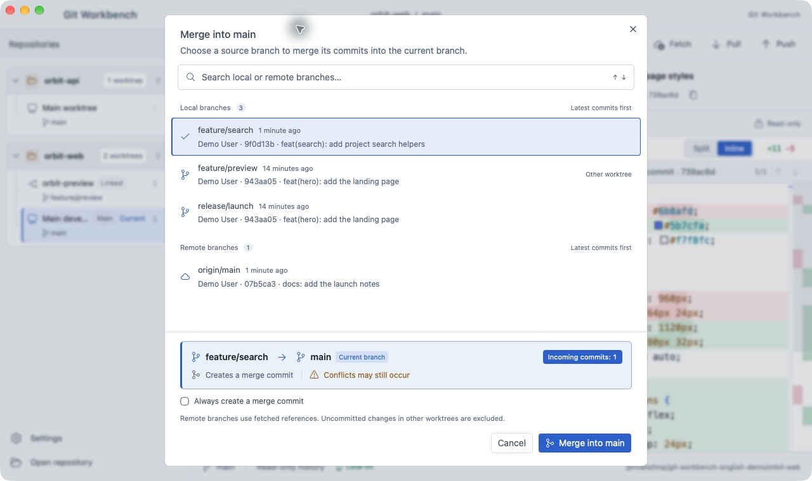

`feature/search → main` 有一个待合入提交，预览提示将创建合并提交。本次随后取消，未执行合并。

1. 选中接收修改的工作树和分支，保持工作区与暂存区干净，点击 **Merge（合并）**。
2. 选择来源分支，核对「来源 → 当前分支」与待合入提交数。
3. 保持默认的优先快进方式，或选择「始终创建合并提交」，再确认合并。

出现冲突时，在编辑器中解决并暂存，再回到 **Complete merge（完成合并）**。未完成合并可通过 **Abort merge（中止合并）** 确认放弃。应用没有内置冲突编辑器。[合并与恢复详情 →](user-manual.md#41-合并分支)

## 17. 获取与拉取更新

先检查远程变化，再将更新合入当前分支。

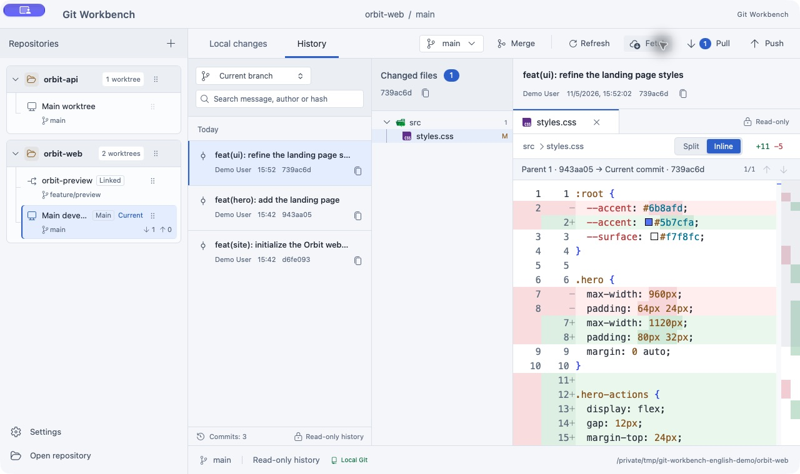

**Fetch（获取）** 后，`main` 显示一个待拉取提交；随后已从本地离线远端成功执行 **Pull（拉取）**。

1. 选择已配置远程的工作树，点击 **Fetch（获取）**。
2. 检查当前分支相对上游的待拉取数量。
3. 点击 **Pull（拉取）**，获取上游并以快进方式更新。

获取只更新远程引用，不合入工作文件；拉取需要上游，双方分叉时需先合并。数量基于本地已获取的引用。示例使用真实本地 bare 仓库作为离线远端，未演示托管服务。

## 18. 推送与首次发布分支

把当前分支的提交发送到对应远程。

截图时 `main` 有一个待推送提交；随后已成功 **Push（推送）** 至本地离线远端。

1. 提交本次修改，并确认当前分支。
2. 已有上游时使用 **Push（推送）**；没有上游时使用 **Publish branch（发布分支）**。
3. 如果出现远程选择提示，确认目标，再检查上游及刷新的同步状态。

首次发布优先使用 `origin`，否则使用唯一远程；目标不明确时需要选择。应用只推送当前分支，不执行强推；远程访问沿用已有 Git 凭据和 SSH 配置。

## 19. 选择外观与界面语言

按阅读习惯选择界面主题和语言。

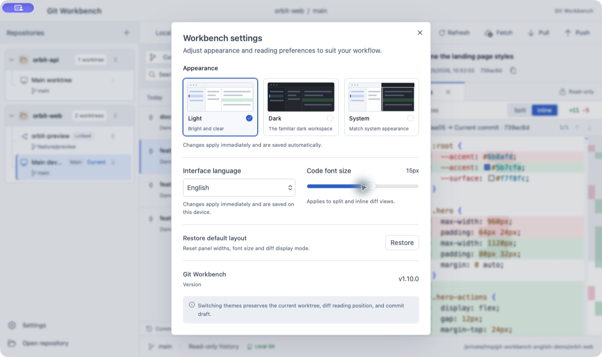

当前选择 **Light（浅色）** 与 **English**，现有代码字号为 **15px**。

1. 打开左下角 **Settings（设置）**。
2. 在 **Appearance（外观主题）** 中选择 **Light / Dark / System（浅色 / 深色 / 跟随系统）**。
3. 在 **Interface language（界面语言）** 中选择 English、中文简体或中文繁體。

选择立即生效并在重启后保留。切换主题保留当前工作树、Diff 阅读位置和草稿；切换语言不翻译仓库内容或已有提交信息，后续 AI 生成会采用所选界面语言。

## 20. 调整布局与刷新状态

为代码留出合适空间，并查看当前工作区的最新状态。

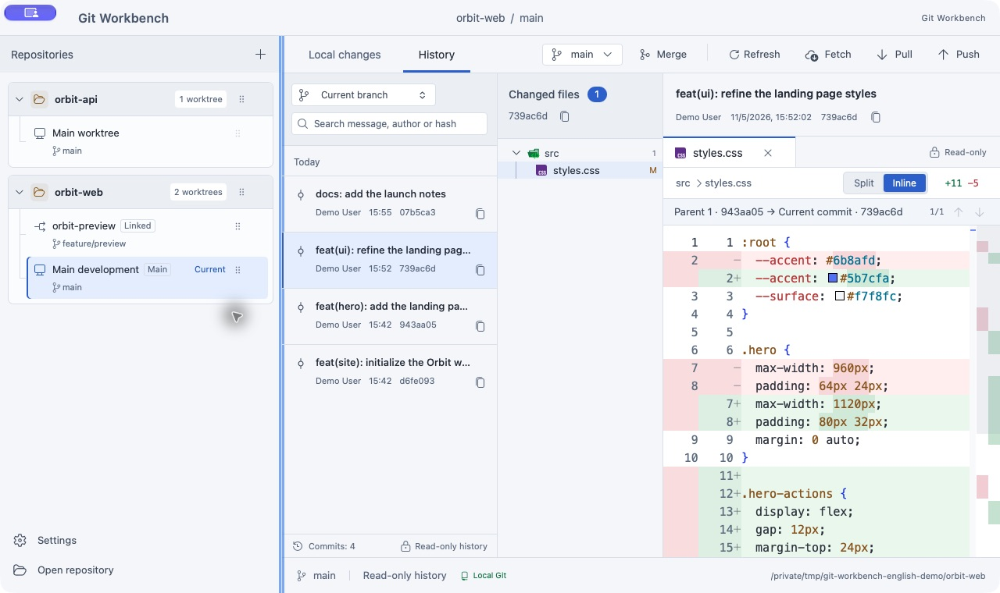

聚焦分隔线后通过 `→` 加宽了侧栏，顶部仍可使用 **Refresh（刷新）**。

1. 拖动分栏边界，调整侧栏、变更列表或历史栏的宽度；分隔线聚焦后也可按 `←` / `→` 调整。
2. 在 **Settings（设置）** 中调整 **Code font size（代码字号）**；需要时点击 **Restore default layout（恢复默认布局）** 下的 **Restore（恢复）**，还原宽度、字号与 Diff 模式。
3. 点击顶部 **Refresh（刷新）**，立即重新读取当前视图。

布局与阅读偏好会保留。文件监听也会在应用前台空闲时刷新本地状态，远程引用仍需点击「获取」。历史页发现新提交时先显示刷新提示，保留正在阅读的 Diff。

安装与更新见[安装说明](installation.md)；更多失败场景和操作限制见[操作手册](user-manual.md)。
