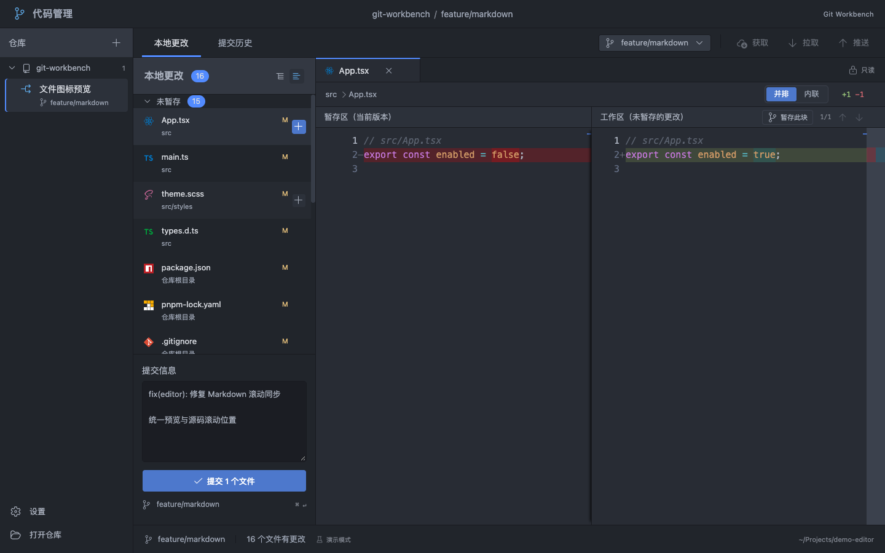
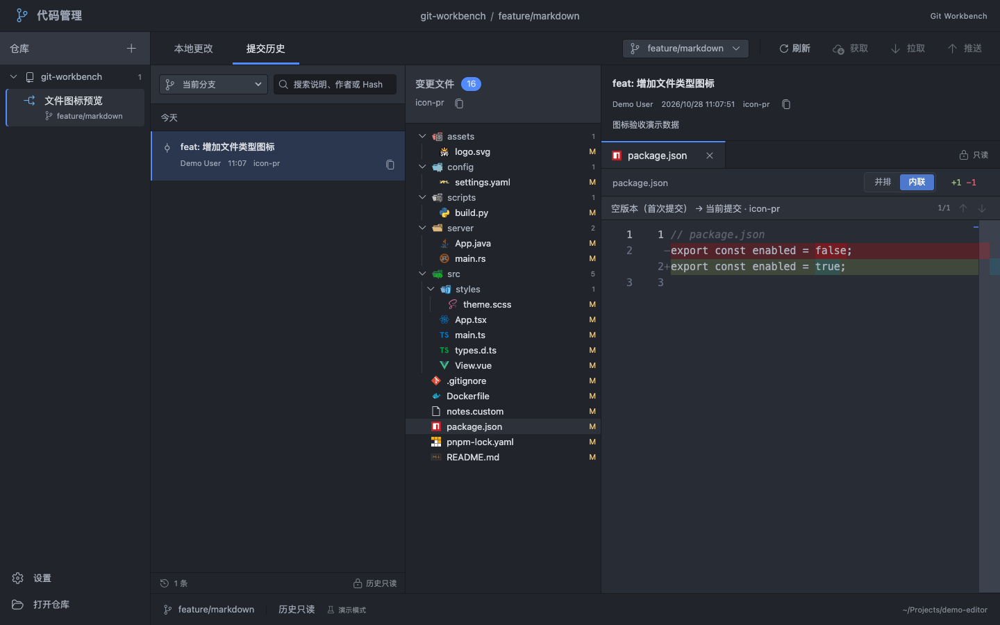

# Git Workbench 操作手册

[English](../user-manual.md) | **简体中文**

适用于 `1.4.0` 桌面正式版本。安装包仅提供 macOS Apple Silicon（arm64），可从 [v1.4.0 Release](https://github.com/asd116725/git-workbench/releases/tag/v1.4.0) 下载；浏览器中的示例数据仅用于体验界面，与真实仓库隔离。

## 1. 认识窗口



- 左侧是仓库及关联 worktree。
- 中间是未暂存/已暂存的文件树和提交表单。
- 右侧是当前文件的只读 Diff。
- 顶部可切换分支和手动刷新，底部显示当前工作区、文件变更数及路径。

分栏边界可以拖动。可通过顶部「提交历史」进入只读三栏视图，见[提交历史](#81-提交历史)。顶部还提供获取、拉取与推送，详见[远程操作](#43-获取拉取与推送)。

macOS 点击左上角红色关闭按钮只隐藏主窗口，仓库、当前 Diff 和未提交草稿保留在内存中。点击 Dock 中的应用图标会恢复原窗口。要真正退出程序，请使用 `⌘Q` 或应用菜单中的「退出」；真正退出后会按下文恢复仓库路径，提交草稿不会跨进程保存。

## 2. 打开本地仓库

1. 点击左下角「打开仓库」或仓库标题旁的 `+`。
2. 通过目录选择器选择已有 Git 仓库，也可填写完整路径后打开。
3. 仓库出现在左侧后，选择要操作的工作区。

支持仓库根目录、仓库内的目录及 linked worktree。此版本不负责新建仓库或克隆远程地址；请先用终端或其他 Git 工具完成。

打开成功后，应用会在当前设备保存仓库路径和上次选中的工作区。重新启动时自动恢复仓库列表，并从 Git 读取最新分支、文件变更和 Diff。某个仓库目录不可访问时会提示错误，其他仓库仍可恢复；失败的路径会保留，供下次启动重试。上次选中的 worktree 已删除时，会选择可用的工作区。

打开失败时，检查目录是否存在、当前账号是否可访问，以及 `git -C /path/to/repository status` 是否正常。Git 的所有权检查等错误会显示在界面中；应先确认目录所有者，再按 Git 的提示处理。

## 3. worktree 工作区

打开仓库时，应用读取 Git 登记的关联 worktree，并将它们列在同一仓库下。每项显示工作区名称及分支；点击即可切换操作目标。

每个 worktree 都有独立文件、暂存区及本次会话的提交草稿。暂存和提交只作用于选中的工作区。切换前可通过底部路径确认目标。

外部新增或删除 worktree 后，应用会通过 Git 元数据监听更新列表，也可点击「刷新」立即读取。目录已经移走或不可访问的工作区不能正常打开。创建、删除、修复 worktree 仍需使用 Git 命令或其他工具。

## 4. 切换分支

点击顶部当前分支按钮打开「分支管理」，输入关键词筛选本地或远程分支（已发布的 v1.1.0 安装包中此弹窗名为「切换分支」）。

- 列表按最近提交时间排序，第二行显示最近提交的作者、短哈希和摘要。
- 使用鼠标选择，或按 `↑` / `↓` 移动、`Enter` 确认、`Esc` 关闭。
- 选择本地分支后在当前 worktree 切换。
- 选择已获取的远程分支时，会创建或使用对应的本地跟踪分支。
- 已被其他 worktree 占用的分支会注明原因并禁止选择。

分支列表不会主动访问远程服务器。看不到新分支时，点击顶部「获取」更新远程引用。

**从 1.4.0 开始提供：**有待同步提交的本地分支会在名称旁显示 `↓` 待拉取数和 `↑` 待推送数，例如 `↓5 ↑0`。每个分支都与自身上游比较，不限于当前分支；两项都为零、没有上游或无法确定数量时不显示数字，远程分支行也不显示。数量基于本地最近获取的上游引用，需要最新远程状态时请先点击「获取」。

未提交修改可能阻止切换。应用遵循 Git 的检查，不会强制覆盖文件；请先提交、用外部工具暂存到 stash，或妥善处理后重试。应用当前没有 stash 操作入口。

## 4.1 合并分支

1. 在左侧选中目标 worktree，确认顶部显示要接收更改的分支。
2. 保持工作区和暂存区干净，点击分支选择器右侧的「合并」。
3. 搜索并选择来源分支，核对「来源 → 当前分支」和待合入提交数。
4. 默认能快进就快进，否则创建合并提交。需要保留显式合并记录时，勾选「始终创建合并提交」。
5. 点击「合并到 当前分支」执行。当前分支已包含来源提交时，无需再次合并。

来源可以是本地分支或已获取的远程分支，也可以是其他 worktree 正在使用的分支；只合入已提交内容，不包含其他工作区未提交的修改。应用不会自动 fetch、stash 或 push。分离 HEAD、尚无提交，以及已有合并、变基等操作未结束时，不能发起新合并。弹窗打开后引用发生变化，需重新检查再执行。

**发生冲突时：**

- 顶部显示当前合并，文件区单独列出「合并冲突」。请在外部编辑器中解决冲突，保存后逐个点击文件旁的 `+` 暂存。应用不提供三方冲突编辑器；暂存表示确认该文件已解决，需先检查内容。
- 常规「未暂存」的目录/整组操作不包含冲突分组，避免批量误标为已解决。
- 所有冲突解决、已跟踪文件修改均暂存后，检查「合并提交信息」，点击「完成合并」或按 `⌘ Enter`。即使解决后的文件与当前 HEAD 完全相同，也可以完成合并。
- 合并提交信息使用独立草稿，原来的普通提交草稿保留。重启会从 Git 恢复合并状态和 Git 默认信息；在应用中手写的草稿仅保存在本次会话。
- 放弃当前未完成合并时，点击「中止合并」并确认。该操作会撤销此次合并及冲突解决过程中的修改，需要保留的内容请先另行保存。已经成功完成的合并不会显示这个入口。

Hook 或签名检查失败时不会绕过检查。应用重新读取实际状态并展示错误；若合并仍待完成，可修复问题后再次点击「完成合并」，或选择中止。通过其他工具发起的合并也会显示相同的恢复入口；其他未完成 Git 操作需要在外部工具中继续或中止。

## 4.2 创建与删除本地分支

以下能力从 1.2.0 开始提供，1.1.0 安装包不包含此功能。顶部当前分支按钮打开「分支管理」，浏览器中同一入口使用标注为「演示模式」的模拟数据。

**创建分支：**

1. 点击「新建分支」，填写分支名称，例如 `feature/search`。
2. 选择起点，默认当前分支；也可选择其他本地分支或已经获取的远程分支。分离 HEAD 时默认当前提交，没有可用起点时需要先完成首次提交。
3. 默认勾选「创建后切换到新分支」。取消勾选只创建引用，当前文件、Diff、历史阅读状态和提交草稿保持不变。
4. 点击「创建并切换」或「创建分支」。远程起点会建立对应的上游跟踪关系，不会推送到远程。

Git 会检查名称是否合法、是否重名，以及是否与现有分支目录层级冲突。切换不会强制覆盖本地修改；如果分支已经创建，但切换因本地修改或其他原因失败，应用会明确提示，新分支仍保留在列表中。处理后可直接从列表切换，无需重复创建。

**删除分支：**

1. 悬停本地分支行，或用 `Tab` 聚焦行内操作，点击垃圾桶按钮。当前分支及任何 Worktree 使用中的分支不可删除；远程分支没有删除入口。
2. 确认分支名称及其相对当前 HEAD 的合入情况。所有提交已包含在当前 HEAD 中时，点击「删除分支」。
3. 如果存在未合入提交，先核对数量，勾选「我了解风险，仍要强制删除此分支」后才可点击「强制删除」。未合入是相对当前 HEAD 而言，已推送到远程不代表已经合入。

删除只移除本地分支引用，不删除工作区文件，也不会删除远程分支。删除后未合入提交可能难以找回，请核对后操作。弹窗预览后目标引用或当前 HEAD 已变化时，操作会被阻止，需点击「重新检查分支」并重新确认。当前 HEAD 尚无提交时，先切换到有提交的分支再检查删除。

合并、变基、挑选提交等操作尚未结束时，不能创建或删除分支。写入期间不可重复提交；执行成功后的列表刷新问题会显示为警告。取消新建或删除返回列表并保留搜索内容。

## 4.3 获取、拉取与推送

以下功能从 1.3.0 开始提供。请先为仓库配置远程地址；应用复用本机 Git 的凭据和 SSH 配置，不提供登录表单。

- **获取**：更新全部已配置远程的引用，清理已删除的远程分支记录，不合入当前分支或修改工作区文件。
- **拉取**：获取当前分支的上游并快进更新。没有上游时先推送建立跟踪；双方都有新提交时，先获取，再用「合并」合入上游分支。应用不会自动变基、stash 或强制覆盖文件。
- **推送**：只上传当前分支到其配置的上游分支，不批量推送其他分支，也不强推。首次发布优先使用 `origin`，否则使用唯一远程；存在多个远程且无默认目标时，在弹窗选择远程并建立上游跟踪。

上传箭头旁的数字表示根据本地已获取的远程引用计算的待推送提交数，仅大于 0 时显示。远程引用可能落后于服务器，点击「获取」可更新；计数未知时不显示数字。提交、切换分支以及获取、拉取、推送完成后会重新读取计数。

执行期间按钮显示对应进度，并暂时禁止其他 Git 写操作。失败时显示 Git 错误；认证失败需先检查本机凭据或 SSH 配置。若提示操作已完成但状态刷新失败，先刷新确认实际状态。

## 5. 文件树与列表

变更分成「未暂存」和「已暂存」两组，同一文件可以同时出现在两组中。组内数字是变更项数，底部总数按文件去重。

点击文件区右上角图标，在目录树与平铺列表间切换。目录箭头用于展开/折叠，文件名用于选择 Diff。目录右侧数字表示后代变更项数量，状态字母常见为 `A` 新增、`M` 修改、`D` 删除、`R` 重命名。

文件和目录较多时可滚动查看。文件路径可在 Diff 顶部的面包屑中确认。

文件列表、目录树、提交历史和 Diff 标签页共用 vscode-icons 图标，按特殊文件名、最长复合后缀及语言匹配；常见目录的展开与收起也有对应图标。图标随应用离线提供，未收录的类型使用通用图标。

目录层级竖线默认隐藏；选中文件时，仅显示它最近父级的引导线。鼠标移入整个文件树区域时显示所有层级竖线，移出后恢复为当前选中文件的父级引导线。

## 6. 阅读 Diff

点击未暂存文件，对比**暂存区 → 工作区**；点击已暂存文件，对比 **HEAD（上次提交）→ 暂存区**。新增仓库没有 HEAD 时，以空内容作为起点。

右上角的「并排 / 内联」切换显示方式；箭头用于跳到上一个/下一个变更块。绿色为新增内容，红色为删除内容。Diff 保留完整上下文，便于对照阅读。

Diff 是只读视图，需要在编辑器修改源码，保存后应用会自动更新，也可手动刷新。二进制、非 UTF-8、超大文本、子模块或未解决冲突可能显示无法作为普通文本展示的说明。请用外部工具处理冲突。

真实 Git 当前仅支持整文件暂存；浏览器演示中的按块暂存不代表桌面版已经提供该能力。

## 7. 暂存与取消暂存

鼠标悬停时，行尾会显示操作按钮：

| 位置 | 未暂存区的 `+` | 已暂存区的 `−` |
| --- | --- | --- |
| 单个文件 | 暂存该文件的全部更改 | 取消该文件的暂存 |
| 目录 | 暂存该目录下当前列出的所有变更文件 | 取消该目录下当前列出的所有暂存文件 |
| 分组标题 | 暂存当前工作区全部未暂存变更 | 取消当前工作区全部暂存变更 |

目录操作包含所有子目录，即使目录被折叠。点击行尾按钮不会只作用于当前选中的 Diff 文件。

取消暂存不会撤销工作区文件内容；它只改变暂存区。取消一个部分暂存文件的暂存后，其全部尚未提交修改会回到未暂存区。

操作进行时会暂时阻止新的写入操作，完成后更新状态。若外部 Git 工具正在操作，可能遇到 `index.lock` 错误；等待其结束后刷新再试。不要在不了解锁来源时直接删除锁文件。

## 8. 提交

1. 检查「已暂存」文件和对应 Diff。
2. 在同一个多行输入框中填写提交信息：第一行作为标题，后续内容作为详细说明，可用空行分隔段落。普通回车换行。
3. 点击「提交 N 个文件」，或在表单中按 `⌘ Enter`（其他平台为 `Ctrl Enter`）。

只提交暂存区内容，未暂存修改继续保留。标题为空、没有暂存变更时不能提交。提交沿用系统 Git 的作者、签名和 hooks 配置；应用不修改全局 Git 配置。

作者未配置时，可针对当前仓库执行：

```sh
git config user.name "你的名字"
git config user.email "你的邮箱"
```

hook、签名或其他 Git 检查失败时，应用显示错误并保留草稿。解决错误后可重试。成功后草稿清空，变更列表刷新。提交草稿只保留在本次应用会话中，重启会丢失。

macOS 版首次执行 Git 操作时，会在用户主目录读取登录和交互 Shell 的 PATH，并在本次应用进程中缓存，供 Git 和 hooks 查找通过 nvm、Homebrew 等安装的 Node、npm、npx。不会自动按仓库的 `.nvmrc` 切换 Node 版本，也不会跳过 Husky 检查。安装工具或修改 Shell 配置后，请用 `⌘ Q` 完全退出应用再打开；关闭窗口只会隐藏，不能重新加载环境。Shell 初始化失败或超过 10 秒时，应用继续使用原有环境。

## 8.1 提交历史

点击顶部「提交历史」。仓库侧栏保持不变，主区从左到右依次为提交列表、所选提交的变更文件树和历史 Diff。首次进入会选择最新提交及其首个变更文件；没有提交或所选提交没有文件变化时显示对应提示。



**浏览和搜索：**

- 默认浏览当前分支；分离 HEAD 时浏览当前提交及其祖先。在历史区的分支筛选器中，可以选择其他本地分支或已获取的远程分支。此筛选只改变浏览范围，不会切换工作区分支，也不会触发合并。
- 提交包含该分支可达的全部历史，包括合并引入的提交。列表采用 Git `--date-order` 顺序，保证子提交在父提交之前，其余按提交时间排序，并按「今天、昨天、日期」分组。
- 每页显示 50 条，点击底部「加载更多」继续浏览。同一轮分页固定起始提交快照，期间新增的提交不会挤入已经加载的列表。
- 搜索在停止输入 300 毫秒后开始，覆盖所选分支的完整历史，不限于已加载的页。提交标题、正文、作者姓名、作者邮箱、完整 Hash 中任意一项包含关键词即可匹配；不区分大小写，不使用正则表达式。
- 提交行显示说明、作者、时间和短 Hash；复制操作取得完整 Hash，便于在其他工具中定位。

**查看文件和比较父提交：**

1. 点击一条提交，查看完整说明和变更文件树。
2. 点击文件查看该次提交的前后内容。普通提交与其父提交比较；首次提交以空版本作为比较起点。
3. 合并提交默认与第一父提交比较。通过「父提交序号 + 短 Hash」选择其他父提交，文件树和 Diff 会同步改变。
4. 切换提交或父提交时，仍存在的文件路径会继续选中，否则选择第一个变更文件。无变更文件时显示空态。

历史文件支持新增、修改、删除、重命名和权限变化。重命名会保留原路径信息；仅权限变化时正文可能相同。二进制、非 UTF-8、超过 2 MiB 的文件及子模块会显示不能作为普通文本比较的说明。历史正文来自 Git 对象，与当前工作文件是否被修改、删除无关。

历史页标明「历史只读」，文件和目录没有暂存、取消暂存或提交按钮，也不提供回退、拣选或历史改写。Diff 默认内联，可切换并排；历史模式与三栏宽度独立于「本地更改」保存，代码字号沿用全局设置。

**刷新和会话状态：**

- 在历史页阅读时，文件监听触发轻量检查。所选分支指向新提交后，显示「历史已更新，刷新查看」，当前列表和 Diff 继续保留。
- 点击刷新重新读取首屏，仍在新结果中的提交和文件会继续选中。读取失败保留已有内容，可按提示重试；筛选的分支已删除时，可换选其他分支或当前分支。
- 历史页不可见时延后检查，下次进入时再检查。普通本地状态刷新不会清空已加载的历史。
- 每个 worktree 在本次会话中独立保留历史筛选、搜索、提交、父提交及文件选择。「本地更改 / 提交历史」之间切换保留各自选择和提交草稿。历史正文和浏览会话不会写入本地持久存储；重启后重新读取。

## 9. 自动刷新、手动刷新与设置

应用监听当前工作区文件及其 Git 元数据（包括 linked worktree 的公共引用）。外部编辑保存、暂存、提交或更新引用后，会合并变化并自动读取本地状态：

- 最后一次文件事件后等待 1 秒；每次自动刷新完成后，至少再间隔 5 秒才执行下一次。这里的 5 秒是刷新冷却期，不是固定轮询。
- 窗口在后台或 Git 写操作进行中时暂缓；返回前台且空闲后处理积累的变化。没有变化时，仅切换窗口不会刷新。
- 自动更新保留当前文件、同一 Diff 的滚动位置和提交草稿；读取失败时保留上次结果并提示。当前文件变更消失时会选择其他变更。
- 应用内暂存、取消暂存和提交仍会立即更新状态，不等待自动刷新冷却期。

顶部「刷新」可主动读取当前视图的最新状态；在历史页中重新读取历史首屏，具体规则见上一节。监听失败时可先手动刷新，再重启应用恢复监听。自动刷新不会访问远程服务器，需要更新远程引用时点击「获取」。

左下角「设置」可以查看当前版本、调整代码字号，或恢复默认布局、字号和 Diff 模式。布局、阅读偏好及仓库路径保存在当前设备；提交草稿只保留在本次会话中。恢复默认布局不会清除已记住的仓库。

从 1.4.0 开始，「设置 → 界面语言」提供 **中文简体 / 中文繁體 / English**，默认中文简体。选择后立即更新应用内文案，下次启动保留选择；恢复默认布局或重置演示数据不会重置语言。切换不修改仓库路径、分支、作者、提交说明、文件内容与 Git 原始输出，系统菜单和系统对话框的标准按钮由操作系统决定。

## 10. 快捷键

| 场景 | 快捷键 |
| --- | --- |
| 提交表单 | `⌘ Enter` / `Ctrl Enter` 提交已暂存内容 |
| 分支选择器 | `↑` / `↓` 选择，`Enter` 切换，`Esc` 关闭 |
| 对话框 | `Esc` 关闭 |

手动刷新、文件暂存和目录暂存目前通过界面按钮操作。

## 11. 常见问题

| 现象 | 处理方式 |
| --- | --- |
| 找不到 Git | 在终端确认 `git --version`，按 macOS 提示安装 Command Line Tools |
| 提示不是 Git 仓库 | 选择已经初始化的仓库；检查路径和访问权限 |
| worktree 不齐或状态旧 | 点击刷新；终端检查 `git worktree list` 和目录是否存在 |
| 新远程分支没有出现 | 点击「获取」更新远程引用 |
| 分支被占用或切换失败 | 查看占用 worktree 或 Git 错误；先处理未提交修改，避免强制覆盖 |
| 暂存失败，存在锁 | 等待其他 Git 操作结束，核对锁来源后处理，再刷新 |
| 提交失败 | 根据错误处理作者、hooks 或签名配置；草稿会保留 |
| hook 提示 `npx: command not found` | 在登录终端确认 `node --version`、`npx --version` 可运行，检查 Shell 初始化配置，再用 `⌘ Q` 完全退出应用并重新打开 |
| 切回应用后内容未变 | 只有监听到变化才自动更新；等待防抖和冷却结束，仍不更新时点击「刷新」，检查是否有监听错误 |
| 提交历史入口置灰或没有合并按钮 | 升级到 v1.1.0 桌面版并打开本地仓库；浏览器演示不提供合并入口 |
| 历史出现更新提示但列表未变 | 为保留当前阅读位置，需要点击刷新后加载新的提交快照 |
| 历史搜索没有结果 | 检查所选分支和关键词；搜索只覆盖该分支可达的提交，不是所有分支汇总 |
| 历史分支读取失败 | 分支可能已在外部删除；切换到其他已有分支或当前分支后重试 |
| 无法使用远程按钮 | 升级到 v1.3.0，打开真实仓库并配置远程；拉取还需上游分支，推送需至少一个提交且未分离 HEAD |

仍有问题时请通过 [Issues](https://github.com/asd116725/git-workbench/issues)提供应用版本、系统/芯片、复现步骤和脱敏后的错误信息。请先备份重要修改，不要上传凭据、私有仓库源码或个人路径。
